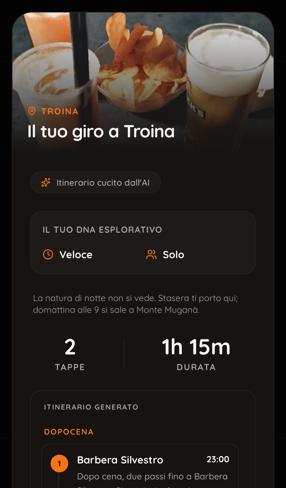
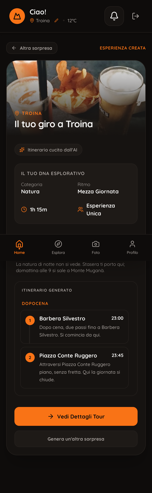

# BORGO-COMPLETO — guardia di pertinenza, correzione del motore nei borghi, schermo che dice il vero

Tre fasi in fila, tre rami pubblicati su GitHub, nessun merge, nessun deploy, nessuna migrazione: la produzione è invariata.
Parte da `borgo-diagnosi` (`8456143`), il report di diagnosi è `docs/prove/2026-10-21-borgo-diagnosi.md`.

| Fase | Ramo | Commit | Cancello |
|---|---|---|---|
| 1 Guardia di pertinenza | `guardia-pertinenza` | `ed03716` | **passato**: 12/12 flussi, tabella dei 6 casi identica alla sezione 5 della diagnosi |
| 2 Correzione del motore nei borghi | `borgo-fix` (da `guardia-pertinenza`) | `c3e3c6f` | **passato con un residuo dichiarato**: suite verde, guardia 12/12, gate dei 10 casi città invariati, C e C2 senza ❌, B1 solo il riquadro; B2 tiene il ❌ del controllo 4 (la scheda «3h» di Sorprendimi), che è un difetto dello schermo assegnato alla fase 3 |
| 3 Schermo che dice il vero | `borgo-schermo` (da `borgo-fix`) | vedi sezione 3 | **passato**: suite verde (2126), guardia 12/12, i 6 casi borgo senza ❌ |

Spesa totale **1,634 $** su 2 $ (soglia di stop 1,8 $): due giri pagati dei casi borgo, tutto il resto a 0 $ (sezione 5).

## 1) Fase 1 — la guardia esegue i 5 controlli di pertinenza (0 $)

**Cosa fa `npm run banco:guardia` ora.** Oltre ai 12 flussi della home (replay dei loro tracciati), rigioca i 6 casi del borgo
dai loro tracciati e applica i 5 controlli di pertinenza della sezione 5 della diagnosi a tutti e 18. I controlli sono in
`scripts/banco/pertinenza.js` (funzione pura sul grezzo, mai da cambiare); i ❌ già noti stanno in
`scripts/banco/pertinenza-noti.json` (una cella = `caso:controllo`); **la guardia fallisce solo su un ❌ nuovo**. In CLAUDE.md:
«prima di ogni merge, guardia 12/12 e pertinenza senza ❌ nuovi».

**Le righe nuove del grezzo, senza toccare il motore** (`scripts/banco/pertinenza-sonda.js`, agganciata in `esteso.live.js` e
`replay.giro.js`; `giro-caso.js` le scrive):
- `senzaMomento`: i candidati del pool che nessun momento prende: la funzione vera `bucketCandidates` è avvolta da `vi.mock` solo
  per annotare (come l'imbuto di `diagnosi-borgo.giro.js`); il motore riceve sempre il risultato vero;
- `intento`: query, categoria e famiglie del traduttore, letti dalla riga che il motore scrive già in console («[Gate B] intent
  tradotto…»), più `requestedFamilies` sul testo;
- `schermo.durate`: i numeri che le schermate del flusso mostrano, con le funzioni vere di `tourTiming.js`; `schermo.riquadro`:
  se il riepilogo del Quiz mostra la scelta; `colazione` per tappa (`isBreakfastPlace`).
Il replay dei tracciati della diagnosi con la sonda è rimasto identico: 6 casi su 6, 0 differenze, 0 uscite in rete.

**Come ho letto i controlli** (sezione 7 della diagnosi, alla lettera; le scelte dove la sezione non diceva):
1. Natura chiesta: Quiz e Sorprendimi dalla scelta; Crea dal **testo** (`requestedFamilies` → verde), non dalle query che il
   traduttore sceglie da solo («Una giornata a Troina» → «parco» non è una richiesta di natura). ❌ se nessuna tappa è di
   natura e il riquadro la mostra lo stesso, o nessuna nota a schermo la nomina.
2. Due intenzioni: solo Crea; le famiglie dalle query del traduttore (senza, dal testo); «—» con meno di due famiglie.
3. Giornata: «giornata» o «domani» nel testo → Mattina e Pomeriggio fra le sezioni, o una nota che spiega perché meno.
4. Durata: i numeri di `schermo.durate` uguali; con un numero solo «—».
5. Colazione: conta e basta. Un posto da colazione conta solo **di mattina** (momento colazione/mattina o arrivo prima delle 11):
   senza questa lettura il bar del dopocena di A e B1 contava come colazione e la tabella non sarebbe stata «non compare».

**CANCELLO 1** — tabella dei 6 casi dal replay dei tracciati della diagnosi: identica alla sezione 5.

| Caso | 1 Natura | 2 Due intenzioni | 3 Giornata | 4 Durata | 5 Colazione |
|---|---|---|---|---|---|
| A Per Te | — | — | — | ✅ 108 = 108 | non compare |
| B1 Quiz Natura | ❌ riquadro «Natura / Parchi e Verde», Monte Muganà raggiungibile (oltre il tetto di cammino), nessun messaggio | — | — | — | non compare |
| B2 Sorprendimi Natura | ✅ Monte Muganà | — | — | ❌ 180 contro 79 | non compare |
| C Crea 23:00 | ❌ Monte Muganà e Silvo Pastorale senza momento, nessun messaggio | ❌ solo storia | ✅ per la nota «mezza giornata» | — | non compare |
| C2 Crea 10:00 | ❌ | ❌ | ✅ | — | non compare |
| Catania | ✅ Villa Bellini | ✅ | ✅ | — | non compare |

**❌ sui casi della guardia** (7, registrati come noti alla fine della fase 1): Sorprendimi Natura e Arte a Troina e a Catania,
controllo 4 (scheda 180 fissa contro 178–184 del giro); `home-troina-crea` e `home-catania-crea`, controllo 2 («Una giornata a X»:
il traduttore sceglie da solo una query di natura e una di storia, e il giro non ha natura); `home-catania-crea`, controllo 3 (alle
12:05 una «giornata» non può avere la Mattina e nessuna nota lo spiega). Proposte (i controlli non si cambiano): per il 2
contare solo le famiglie nominate nel testo; per il 3, in un giro che parte dopo la mattina, chiedere i momenti ancora possibili.

File: `scripts/banco/pertinenza.js`, `pertinenza-sonda.js`, `pertinenza-noti.json`, `guardia.mjs`, `giro-caso.js`, `esteso.live.js`,
`replay.giro.js`; test `src/__tests__/scripts/pertinenza.test.js` (14, fra cui le copie dei tipi tenute uguali a `borgoConfini.js`).

## 2) Fase 2 — le sei decisioni nel motore

| # | Decisione | Dove | Cosa NON risolve |
|---|---|---|---|
| 1 | Solo borgo: nel conto della mezza giornata entrano natura e panorami delle ricerche (visitabili, non organizzazioni, entro `NATURA_BORGO_KM`, voto e orari). Con «giornata»/«domani» nel testo la finestra resta quella chiesta. La riga «X si gira in mezza giornata» solo se la finestra è stata davvero accorciata e mai su un giro della sera | `aiRecommendationService` (`naturaNelConto`, `giornataChiesta`), `borgoConfini.chiedeGiornata` | Un borgo senza natura vicina e aperta resta a mezza giornata. Con «giornata» il pomeriggio di Troina ha 123–126 minuti di tempo libero dichiarato: il pool non ha altro. Ho letto «almeno mattina e pomeriggio» come «la finestra non si accorcia»: la sera resta (aperitivo, cena) |
| 2 | `TYPE_CATEGORIES`: `scenic_spot`, `observation_deck` → punti panoramici + natura; `hiking_area`, `nature_preserve`, `national_park`, `state_park`, `garden` → natura | `momentSelection` | La mattina non ha «natura» fra le sue categorie: Monte Muganà entra al pomeriggio e nella passeggiata, non la mattina. Nelle città cambia una tappa a Napoli e la sera di Trastevere (tabella sotto): nessuna ancora, nessun essenziale, nessun gate; la modifica resta per tutte le scale |
| 3 | Dopo il tramonto nessuna tappa di natura «da fuori» in nessun flusso; la riserva «mai vuoto» resta un dopocena (bar) con la sua passeggiata in paese; nota di Ivano se la natura era chiesta; di giorno, con natura chiesta, la passeggiata prende per prima natura o panorama, nel borgo fino a 30 minuti | `borgoConfini.isNaturaDaFuori`, `NOTA_NATURA_NOTTE`; `aiRecommendationService` (`senzaNaturaDiNotte`, `naturaNote`, `naturaPrima`, Per Te a temi `invalidAt`); `daySkeleton` (riserva), `momentSelection` (`maxWalkMinutes`, `naturaPrima`) | Di notte non c'è natura: il giro è bar + piazza + nota, e la nota non è un tour di domani. Il tramonto è quello astronomico di `sunTimes` (16:25 UTC a Troina il 15/10), lo stesso del narratore; «dopo il tramonto» è l'inizio del momento (per la passeggiata l'arrivo stimato: drink + 45 min). «Da fuori» = tipo selvatico, nome da monte/riserva/sentiero/bosco, o un parco a più di 1 km dal centro (3 in città): una spiaggia o un lungomare restano. Il tetto a 30 minuti della passeggiata di giorno non si è visto in nessun caso (Monte Muganà entra già al pomeriggio) |
| 4 | Solo borgo: nel dopocena entra un posto aperto all'arrivo con `bar` o pub fra i tipi anche se il tipo principale è da ristorante; la ricerca mirata della sera aggiunge «pub» | `momentSelection.bucketCandidates` (`borgo`, `isBarOrPub`), `searchMomentCandidates` (`borgoPub`) | La scelta la fa il merito: Black & White entra in Per Te (A), nel Quiz e in Sorprendimi vince Barbera Silvestro (dalla ricerca con «pub»). La ricerca con «pub» è una richiesta nuova a Google: il replay dei vecchi tracciati la segna come uscita |
| 5 | Nel borgo (scala confermata, non `isSmallTown`) bastano 5 recensioni per natura e panorami | `candidateScoring.passesQualityThreshold` (`borgoNatura`), `selectScoredCandidatePool` | Il Belvedere della Piazza Conte Ruggero (5,0 su 8) entra nel conto e nelle tappe di giorno (guardia, Sorprendimi Natura a mezzogiorno); di notte è un panorama in paese e può entrare nella passeggiata, ma a Troina la passeggiata ha preso la Piazza |
| 6 | Un posto di tipo parco o natura, o con soli tipi generici, con nome da organizzazione non è una tappa e non entra nel conto | `borgoConfini.isOrganizzazione`, applicato a tutte le ricerche in `placesDiscoveryService` e al conto del borgo | Lettura dichiarata: i «soli tipi generici» contano **insieme al nome** (un rudere o una chiesa con il solo `point_of_interest` resta una tappa); un'agenzia con un nome neutro resta. **Troina resta esattamente sulla soglia**: 3 luoghi della lista + Monte Muganà = 4; se Monte Muganà non fosse aperto nella finestra tornerebbe la mezza giornata |

Una correzione dopo il giro R1 (nel codice finale, provata in replay sui tracciati di R1 e poi nel giro R2): il drink di riserva
cerca un bar, e la categoria chiesta (natura) non filtra quella ricerca (`drinkDiRiserva`): in R1 Sorprendimi Natura alle 23 era
Piazza + tempo libero, perché i bar trovati venivano tolti come «non natura».

### Replay dei 10 casi città di PIENA-2 (0 $, prima e dopo)

Tracciati completi dei due giri di PIENA-2 (`2026-10-19-banco-esteso-c10[-2]-tracciati-completi.json.gz`), rigiocati sul codice di
fine fase 1 («prima») e sul codice finale della fase 2 («dopo»). Misure: tappe, tempo libero, essenziali della lista di controllo,
ancore nel giro, gate «conosce la città» e «giornata piena» dell'asticella C10. **Nessun caso città perde un'ancora o un
essenziale, nessun gate cambia.** Le differenze:

| Caso | R1 | R2 |
|---|---|---|
| Catania, Roma neutra, Roma A, Roma B, Palermo, Lecce, Troina mezza | identici | identici |
| Napoli | Castel Sant'Elmo → Belvedere Villa Floridiana (pomeriggio, decisione 2: `scenic_spot` ora ha una categoria); tappe, tempo libero, essenziali, ancore, gate uguali | lo stesso, più Da Maria → Trattoria canta napoli a pranzo (cascata); gate uguali |
| Trastevere | il pomeriggio prende il Belvedere del Salviati (decisione 2) e perde la Basilica di Santa Cecilia; la sera cambia a cascata (Belvedere Tarpeo → Piazza Navona, trattorie diverse); tappe 12 = 12, tempo libero uguale, ancore uguali, gate uguali | identico a R1 |
| Troina, giornata | 3 → 11 tappe, 1 → 2 ancore, «giornata piena» da non applicabile a vero (R1) / falso (R2, 67 min di tempo libero): è il borgo, atteso | — |

Nota: lo script di confronto segnalava «essenziale perso: Foro Romano» a Trastevere; è il regex della lista di controllo
(`ESSENZIALI_CONTROLLO`) che prende il ristorante «La Taverna dei Fori Imperiali» come se fosse il Foro Romano. Nessun Foro Romano
era nel giro né prima né dopo. Proposta: restringere quel regex.

### I casi borgo: replay, poi il giro pagato

- **Replay dei tracciati della diagnosi col motore nuovo** (0 $): Per Te A dà Black & White + Piazza senza uscite; Quiz, Sorprendimi
  e i due Crea chiedono a Google quello che i vecchi tracciati non hanno (la ricerca della sera con «pub», i pasti da un altro
  punto) e lo dichiarano come uscita; Catania identica 13/13.
- **Giro pagato R1** (`docs/prove/dati/2026-10-16-borgo-fix.json`, tetto 1 $): 0,835 $, Catania saltata dal tetto (la sua
  invarianza è nel replay, 13/13). Sorprendimi Natura ancora senza bar (vedi la correzione sopra).
- **Giro pagato R2 sul codice finale** (`-2.json`, 5 casi di Troina): 0,799 $. Il replay dei suoi tracciati è identico 5/5,
  0 uscite. **I numeri finali sono quelli di R2.**

### Tabella di pertinenza prima/dopo (R2; Catania dal replay)

| Caso | Prima (diagnosi) | Dopo la fase 2 | Dopo la fase 3 |
|---|---|---|---|
| A Per Te | — — — ✅ — | — — — ✅ (105 = 105) — | uguale |
| B1 Quiz Natura | ❌ — — — — | ❌ **solo il riquadro** (la nota c'è) — — — — | ✅ — — — — |
| B2 Sorprendimi Natura | ✅ — — ❌ — | ✅ (nota) — — ❌ (180 contro 75) — | ✅ — — ✅ (75 = 75) — |
| C Crea 23:00 | ❌ ❌ ✅ — — | ✅ ✅ ✅ — — | uguale |
| C2 Crea 10:00 | ❌ ❌ ✅ — — | ✅ ✅ ✅ — — | uguale |
| Catania | ✅ ✅ ✅ — — | ✅ ✅ ✅ — — | uguale |

### Le tappe di C e di B2, per esteso

**C — «fammi fare domani una giornata tra natura e luoghi storici», Troina, 23:00 (tour di venerdì 16/10)**

| Prima (diagnosi) | Dopo (R2) |
|---|---|
| 10:30 Chiesa Madre · 10:53 Torre Capitania · 12:30 A'Pescheria · «Troina si gira in mezza giornata.» · titolo «Culturale viaggio di Troina» | 10:30 Chiesa Madre · 10:53 Torre Capitania · 12:30 A'Pescheria · 14:30 Via Conte Ruggero · **15:15 Monte Muganà** · 15:45 tempo libero 123 min · 18:00 Barbera Silvestro · 18:45 Piazza Conte Ruggero · 20:00 AL216 · nessuna riga sulla mezza giornata |

C2 (stesso testo alle 10:00) è identico a C in entrambi i giri. In R1 il pomeriggio era Piazza Conte Ruggero + Monte Muganà e
l'aperitivo Snack Bar Saint Michel + Via Conte Ruggero: stesse famiglie, posti diversi.

**B2 — Sorprendimi Natura, Troina, 23:00**

| Prima (diagnosi) | Dopo (R2) |
|---|---|
| 23:00 Monte Muganà · 23:49 «Cammina con Turi – Escursioni Nebrodi» (un'agenzia) · tempo libero · scheda «3h» su un giro di 79 min | 23:00 Barbera Silvestro · 23:45 Piazza Conte Ruggero · nota «La natura di notte non si vede. Stasera ti porto qui; domattina alle 9 si sale a Monte Muganà.» · (fase 3) scheda 1h 15m = giro |

B1 (Quiz Natura, 23:00): prima Bar Sunshine + Via Conte Ruggero col riquadro «Natura / Parchi e Verde»; dopo Barbera Silvestro +
Piazza Conte Ruggero, la stessa nota, e (fase 3) il riquadro non mostra più la scelta. A (Per Te, 23:00): prima Bar Sunshine +
Piazza; dopo Black & White + Piazza (decisione 4).

**La guardia della home** con il motore nuovo: 12/12 senza uscite in rete (i tracciati della home non sono stati rifatti).
A Troina a mezzogiorno Sorprendimi Natura passa da Azienda Silvo Pastorale al Belvedere della Piazza Conte Ruggero (decisioni 5 e
6); «Una giornata a Troina» alle 12:05 dà pranzo, pomeriggio, aperitivo e cena (7 tappe) invece di una chiesa e tempo libero.

Test: `src/__tests__/services/borgoFix.test.js` (8); cinque test del giro corto del borgo che usavano «Domani una giornata a
Troina» ora usano «Un giro a Troina» alle 8:00 (la decisione 1 tiene intera la giornata chiesta); il test TROINA-FIX del Quiz
Natura delle 12:06 ora attende il conto con Monte Muganà e nessuna riga sulla mezza giornata.

## 3) Fase 3 — lo schermo dice il vero

- **Riquadro del Quiz** (`src/lib/quizRiquadro.js`, `QuickPathSummary`): mood e ispirazione si mostrano solo se almeno una tappa è
  della famiglia scelta (`sceltaConfermata`: natura/parchi/montagna/vulcano → natura o panorama; storia → luogo storico; cibo →
  un locale; mare, moda, canali, relax dai tipi e dal nome; «Città» sempre). `QuickPath` passa la scelta principale (`mainId`).
  Il banco scrive nel grezzo lo stesso esito (`schermo.riquadro.mostrato`) con la stessa funzione.
- **Una sola durata mostrata** (`tourTiming.displayedTourMinutes`): l'orologio (`tourSpanMinutes`, attese comprese) quando le
  tappe hanno gli orari, la somma di soste e spostamenti solo quando mancano, la durata del motore solo senza tappe. La usano la
  scheda in home (`DashboardUser`), il dettaglio (che stampa quella stringa), il riepilogo del Quiz, Sorprendimi (non più 180 fisso,
  niente «3h» di ripiego) e le notifiche. Il test del Quiz «senza orari la card usa la durata del motore» ora attende la somma.
- **«Qui la giornata si chiude»**: `_homeDaMotore` (il giro della sera di Per Te e il tour misto del borgo) passa `giornata: false`
  a `generateItinerary`, che lo porta a `stopData` nel contesto di composizione. Nessun cambio al motore di scelta.
- **La nota della natura di notte** (decisione 3) si vede anche nel riepilogo del Quiz e in Sorprendimi (`data-natura-note`), non
  solo in Crea: senza, B1 e B2 avrebbero avuto la nota solo nel grezzo.

**Prova in WebKit (iPhone 13), a 0 $** — `scripts/prova-schermo/borgo-schermo.webkit.mjs`: porta e titolo verificati prima delle
credenziali (vite di questo repo su 5181), accesso con l'account di prova, orologio del browser a giovedì 15/10 alle 23:00,
posizione a Troina; le risposte di places-proxy e openai-proxy arrivano dai tracciati del giro R2 con la stessa rete del replay
(nessuna chiamata a Google o a OpenAI), il preflight della quota legge una riga vuota. Schermate in `docs/prove/schermate/borgo-schermo/`.

| Scenario | Schermata | Cosa si vede |
|---|---|---|
| Quiz Natura → Parchi e Verde, Veloce, Solo, Troina, 23:00 | `docs/prove/schermate/borgo-schermo/01-quiz-natura-sera.png` | Il riquadro «Il tuo DNA Esplorativo» mostra solo Veloce e Solo (niente «Natura / Parchi e Verde»); sotto, la nota «La natura di notte non si vede. Stasera ti porto qui; domattina alle 9 si sale a Monte Muganà.»; 2 tappe, durata **1h 15m** (23:00 Barbera Silvestro, 23:45 Piazza Conte Ruggero); 0 uscite in rete, 4 risposte servite dal tracciato, 0 errori di pagina |
| Sorprendimi → Esperienza Naturale, Troina, 23:00 | `docs/prove/schermate/borgo-schermo/02-sorprendimi-natura-sera.png` | La scheda dice **1h 15m** (prima «3h» fisso), uguale al giro; la nota sotto le statistiche; le stesse 2 tappe; 0 uscite, 0 errori |

Due cose viste nelle schermate e non toccate (fuori dall'elenco della fase 3, si propongono):
- la scheda di Sorprendimi ha un riquadro suo con «Categoria: Natura» sopra un bar e una piazza: la stessa regola del riquadro del
  Quiz (`sceltaConfermata`) varrebbe anche lì;
- in un Quiz o Sorprendimi della sera l'ultima tappa dice «Qui la giornata si chiude» (TESTI lo ammette dalle 18:00): la fase 3
  lo toglie solo dal giro della sera di Per Te e dal tour misto del borgo, come chiesto.

**CANCELLO 3**: suite verde (165 file, 2126 test), guardia 12/12, pertinenza dei 6 casi borgo senza ❌ (tabella sopra). Restano
tre ❌ noti, tutti sui casi della guardia e tutti limiti dei controlli: `home-troina-crea:3` e `home-catania-crea:3` (una
«giornata» chiesta alle 12:05 non può avere la Mattina: proposta sopra), `home-catania-crea:2` (le famiglie le sceglie il
traduttore, non il testo).

## 4) Produzione, rami, file

- **Produzione invariata**: nessun deploy, nessuna migrazione, nessun merge; le liste di Troina (15/10 e 16/10) e Catania (15/10)
  erano già sul server (controllato in lettura prima del giro: `city_knowledge`, versione `c10b-7`), quindi i giri non ne hanno
  scritte di nuove. Come ogni banco, i giri hanno scritto biglietti `label = 'test'` in `ai_generation_ticket` e righe di cache in
  `places_cache`.
- **Rami**: `guardia-pertinenza` → `borgo-fix` → `borgo-schermo`, tutti pubblicati; il merge lo decide il regista.
- **Grezzi e tracciati**: `docs/prove/dati/2026-10-16-borgo-fix[.json|-tracciati.json.gz]` (R1) e `-2` (R2). La guardia rigioca
  i 5 casi di Troina dai tracciati di R2 e Catania da quelli della diagnosi (`guardia.mjs`, `TRACCIATI_BORGO_DEFAULT`).
- **Privacy**: nessuna email, nessun id utente, nessuna posizione di persone nei file e in questo report.

## 5) Spesa

| Voce | Spesa |
|---|---|
| Fase 1 (replay, guardia, suite) | 0 $ |
| Fase 2, replay città e borgo, guardia | 0 $ |
| Giro R1 dei casi borgo (5 di Troina; Catania saltata dal tetto 1 $) | 0,835 $ |
| Giro R2 (ripetizione, codice finale) | 0,799 $ |
| Fase 3 (suite, guardia, prova WebKit coi proxy dal tracciato) | 0 $ |
| **Totale** | **1,634 $** su 2 $ (stop a 1,8 $ non raggiunto) |

## Cosa ho dato per vero senza verificarlo

- **Che B2 vada considerato «senza ❌» al cancello 2** benché il controllo 4 fosse ancora rosso: il difetto (scheda fissa a 3h)
  è uno schermo e il task lo assegna alla fase 3; non mi sono fermato. Se la lettura giusta era fermarsi, la fase 3 va riletta
  come lavoro fatto oltre il cancello.
- **Il senso di «almeno mattina e pomeriggio»** nella decisione 1: ho tenuto intera la finestra chiesta (sera compresa) invece
  di accorciarla alle 18:00. Il pomeriggio di Troina resta con due ore di tempo libero dichiarato.
- **Il senso di «soli tipi generici»** nella decisione 6: insieme al nome da organizzazione, non da soli (altrimenti anche San
  Silvestro e i Ruderi del Monastero Nuovo sarebbero spariti dai giri).
- **La riserva «mai vuoto» come drink + passeggiata**: la decisione dice che non diventa natura; che il drink di riserva abbia
  la sua passeggiata (come il Veloce) è una mia scelta per tenere «belvedere e piazze dentro il paese».
- **La nota della natura anche nel Quiz e in Sorprendimi** (fase 3): la decisione 3 la chiede; dove mostrarla non era scritto.
- **Il tramonto astronomico** (`sunTimes` sul centro della città) come «tramonto del giorno del tour»: a Troina il 15/10 è alle
  18:25; la passeggiata dell'aperitivo delle 18:00 conta dall'arrivo stimato (18:45) e quindi è «di notte».
- **Che le 2 ripetizioni siano R1 e R2 dello stesso giro**, con Catania solo in replay: il tetto di 1 $ per giro l'ha saltata e
  il suo replay sul motore nuovo è identico 13/13.
- **Che i cambi di Napoli e Trastevere siano effetto della decisione 2**: lo dicono le tappe nuove (due belvederi `scenic_spot`),
  non un replay con una decisione alla volta.
- **Che i tracciati della home non vadano rifatti**: la guardia non ha segnato uscite in rete; le richieste dei 12 flussi a
  mezzogiorno non sono cambiate.
- **Le schermate di WebKit** mostrano lo stesso giro del grezzo di R2 perché i proxy rispondono dal suo tracciato; i prompt
  del browser possono differire da quelli dello script (profilo, DNA) e il replay li serve comunque in ordine.
