# NAV-1 — la navigazione non si blocca

Ramo `nav-1` da main `b096732` (suite di partenza 2061 verde). Base: `docs/prove/2026-10-20-nav-diagnosi.md` (punti B1–B7).
Nessuna migrazione, nessuna modifica a motore, proxy, testi dei tour, Profilo e DNA. Telemetria invariata (NAV-2). Nessun merge su main.

## Esito in breve

- **I 5 punti sono fatti** e provati in tre modi:
  - 7 test rosso→verde, che falliscono su `b096732` e passano su `nav-1`;
  - 16 test unitari sui moduli nuovi;
  - **7 prove su 7 passate nel motore di Safari** (WebKit, profilo iPhone 13, posizione simulata), con le schermate.
- **La prova WebKit ha trovato un errore vero**, prima del commit: Safari rifiuta `setInterval` chiamato come metodo di un altro oggetto («Can only call Window.setInterval on instances of Window»). Il tracciamento nuovo non partiva affatto in Safari, mentre in jsdom i test passavano. Corretto in `navTracking.js` (i timer si chiamano avvolti).
- **Suite 2084 verde** (2061 + 23), lint 0 errori, build ok.
- **Anteprima Vercel:** https://unnivai-git-nav-1-aispace-projects.vercel.app (deploy `unnivai-jcth652l1-aispace-projects.vercel.app`, Ready). **È dietro la protezione dei deploy di Vercel**: chi non è entrato in Vercel finisce su `vercel.com/sso-api`. Per questo **non ho potuto verificare l'accesso all'app sull'anteprima** (sezione 6). Non ho cambiato nessuna impostazione.
- **Un testo nuovo da approvare:** il link «Apri in Mappe» sotto il messaggio del percorso. Tutti gli altri testi sono quelli di Ivano alla lettera, e **tutti entrano nello spazio** (vanno a capo, nessuno è tagliato: schermate 01, 04, 06, 12, 13).

## 1) Cosa è cambiato, punto per punto

### Punto 1 — Tracciamento sempre attivo (B1)

- **Prima:** il `watchPosition` della navigazione partiva solo se `getCurrentPosition` rispondeva entro 5 s.
- **Ora** (`src/lib/navTracking.js`, `avviaTracciamento`):
  - il `watchPosition` ad alta precisione parte **subito**, all'avvio, senza aspettare un primo fix;
  - dopo un errore (timeout, posizione non disponibile) riprova dopo 5 s;
  - dopo 30 s senza notizie si riavvia (su iOS a volte non arriva né la posizione né l'errore);
  - si riavvia al **ritorno in primo piano**, anche dopo un «negato»: chi attiva la posizione in Impostazioni e torna su Safari riparte senza ricaricare.
- **Gli stati:**
  - `attesa`: dopo 5 s compare «Cerco il segnale…»;
  - `ok`;
  - `perso`: più di 30 s senza posizioni dopo averne avute; compare «Ho perso il segnale…»;
  - `negato`: compare il messaggio con le Impostazioni.
- **Le tappe si sbloccano** con la stessa logica di prima (geofence, «arm-then-fire»), per qualunque posizione arrivi, anche dopo minuti.
  - Il corpo della posizione è lo stesso codice di prima, spostato in `onNavPosition` (`MapPage.jsx`) e letto da un ref, quindi sempre aggiornato all'ultimo stato.
- **Senza posizione** la mappa si mette sulla prima tappa ancora da fare, come prima, ma intanto continua a cercare.
- **I due vecchi messaggi toast sono tolti**, perché sostituiti dai testi di Ivano nella barra:
  - «📍 Posizione non condivisa. Partiamo dalla prima tappa del tour.»
  - «📍 GPS non disponibile ora… poi ti raggiungeremo appena il segnale c'è», che era la promessa falsa.
- **`nav_start` è registrato come prima:** una volta, al primo fix entro 5 s, oppure con `gps_denied` se il fix non arriva in 5 s o la posizione è negata.

### Punto 2 — Ripresa (B2)

- **Il salvataggio** (`src/lib/navSession.js`, chiave `dvai_nav_giro_v1` in `localStorage`, che sopravvive alla chiusura della scheda e alla riapertura da Home):
  - cosa si salva: tour, tappe fatte, tappe saltate, bersaglio di «Naviga», ora d'inizio, mezzo;
  - quando: a ogni cambio durante la navigazione;
  - quando si cancella: con «Fine», a fine giro, con «Chiudi il giro», oppure se il giro è iniziato da più di 12 ore (alla lettura).
- **Dove si propone:**
  - **sulla mappa** con lo stesso tour, dopo una ricarica o una scheda scaricata da iOS (`MapPage`): «Hai un giro in corso: tappa N di M. Riprendi?»;
  - **all'apertura dell'app fuori dalla mappa** (`src/components/GiroInCorso.jsx` in `App.jsx`, solo con un utente entrato): «Riprendi» porta alla mappa e riprende subito.
- **Cosa riprende «Riprendi»:** stesse tappe fatte e saltate, stessa ora d'inizio (il tempo nel riepilogo resta vero), stesso bersaglio.
- **La telemetria della ripresa:** non apre un nuovo `nav_start`. Le tappe dopo la ripresa restano nella sessione di telemetria iniziata prima.
- **Il dialogo:** `src/components/Map/GiroRipresaDialog.jsx`, lo stesso per la mappa e per l'apertura dell'app.

### Punto 3 — Comandi (B3, B4)

- **Nella barra** (`NavigationHUD.jsx`) ci sono **«Sono arrivato»** e **«Salta»**, sempre visibili finché c'è una tappa da raggiungere.
  - Valgono anche senza GPS, ed è il «segna le tappe a mano» del messaggio di posizione negata.
  - «Sono arrivato» resta anche nella scheda della tappa.
- **Una tappa saltata** non si insegue più, non conta come fatta e conta per la fine del giro (tutte fatte o saltate → riepilogo).
  - L'evento DNA «tour completato» parte solo se tutte le tappe sono **fatte**, come prima.
- **Tappa superata** (`src/lib/navPassaggio.js`): mai uno sblocco automatico, sempre la domanda «Sei passato da [nome]?» con «Vista» / «Saltala». La domanda compare in due casi:
  - **di passaggio:** sei arrivato entro 80 m dalla tappa (o il doppio della soglia, se il GPS è impreciso) senza entrare nella soglia, e ora ti allontani di almeno 40 m (o della soglia);
  - **dopo una pausa:** nessuna posizione per almeno 60 s (schermo bloccato, app in background), e ora sei più vicino alla tappa dopo di quanto lo sia la tappa stessa, cioè sei già oltre.
- **La domanda si fa una volta per tappa.**

### Punto 4 — Schermo acceso

- `src/lib/wakeLock.js`: Screen Wake Lock all'avvio della navigazione, richiesto di nuovo al ritorno in primo piano (iOS lo rilascia in background), rilasciato con «Fine», a fine giro e all'uscita dalla mappa.
- Dove l'API manca o il browser la rifiuta non succede niente: nessun errore, nessun messaggio (test unitari).
- Nel WebKit della prova l'API c'è (`'wakeLock' in navigator` = vero) e nessun errore di pagina. **Che lo schermo resti davvero acceso si vede solo su un iPhone.**

### Punto 5 — Messaggi (B5, B6, B7)

- **I testi:** `src/lib/navMessaggi.js` (`NAV_TESTI`), alla lettera.
- **Un avviso alla volta**, dal più grave (`avvisoNavigazione`):
  1. posizione negata;
  2. senza rete (lo stato `isOffline` c'era ma non era mostrato);
  3. percorso non calcolabile;
  4. segnale perso;
  5. segnale in attesa, solo dopo 5 s.
- **Percorso non calcolabile:**
  - lo stato di Google Directions **non si mostra più**: prima l'HUD stampava `routeStats.error` così com'era;
  - compare il testo di Ivano, con sotto il link **«Apri in Mappe»**: Mappe di Apple verso la prossima tappa, a piedi o in auto secondo il mezzo;
  - «passa alla tappa dopo» è il tasto «Salta», già nella barra.
- **«Apri in Mappe» è l'unico testo non di Ivano: da approvare.**

## 2) I test rosso→verde

`src/__tests__/pages/mapPageNav1.test.jsx` monta la MapPage vera con un GPS finto comandato dal test (Google Maps, Supabase e servizi finti). Ho lanciato lo stesso file su una copia di `b096732`: **7 rossi**, ognuno per il motivo giusto. Su `nav-1`: **7 verdi**.

| Test | Su `b096732` fallisce perché |
|---|---|
| tracciamento attivo dopo un primo GPS di 30 s, e la prima tappa si sblocca quando arriva | nessun watch ad alta precisione attivo (`expected 0 to be greater than 0`) |
| ripresa dopo ricarica (tappa fatta col GPS, smontaggio, rimontaggio, «Riprendi») | nessuna proposta «Hai un giro in corso: tappa 2 di 3» |
| giro iniziato da più di 12 ore non riproposto (e cancellato) | il giro non viene nemmeno salvato (precondizione). Su `b096732` non si può arrivare alla regola delle 12 ore |
| «Sono arrivato» nella barra | il tasto non c'è nella barra |
| domanda sulla tappa superata, poi «Saltala» | nessuna domanda |
| messaggio per posizione negata | il testo non c'è |
| nessun codice inglese per il percorso fallito | `ZERO_RESULTS` a schermo |

Unitari (`src/__tests__/lib/nav1.test.js`, 16):
- tracciamento: attesa, ok dopo minuti, perso e ritorno, riprova dopo un timeout, ripresa dopo un «negato» al ritorno in primo piano;
- giro salvato: salvataggio, scadenza delle 12 ore, chiave;
- tappa superata: di passaggio, dopo una pausa, avvicinamento senza domanda;
- schermo acceso: senza API, rifiuto, rilascio e nuova richiesta;
- messaggi: ordine, testi alla lettera, link.

## 3) Le prove nel motore di Safari

**Come:**
- `scripts/prova-nav/nav1.webkit.mjs`: Playwright 1.61 con WebKit 26.5, profilo iPhone 13, vite su `localhost:5181`.
- Prima delle credenziali ho verificato porta, processo e titolo «DoveVai», come da CLAUDE.md.
- Accesso con l'account di prova, credenziali lette da `.env.local` e mai stampate. La sessione è rimasta in una cartella temporanea, poi cancellata.
- **La posizione è un GPS finto** al posto di `navigator.geolocation`, con la stessa interfaccia (`watchPosition`, `getCurrentPosition`, `clearWatch`, errori con `code` 1/2/3), comandato dalla prova.
- Mappa e Directions sono le vere API di Google. Tappe: 4 monumenti pubblici di Catania.
- Esiti grezzi: `docs/prove/dati/2026-10-20-nav-1-webkit.json`.

**Giro finale sul codice del commit: 7 su 7.**

| # | Prova | Esito | Cosa si è visto |
|---|---|---|---|
| 1 | primo GPS dopo 30 s | ✅ | dopo 6 s «Cerco il segnale…»; a 30 s un watch ad alta precisione attivo; la posizione arriva → la prima tappa si sblocca («Tappa 2/4»), il messaggio sparisce |
| 2 | GPS che sparisce e torna | ✅ | 40 s senza posizioni → «Ho perso il segnale…»; una posizione → il messaggio sparisce |
| 3 | posizione negata | ✅ | messaggio di Ivano; «Sono arrivato» nella barra segna la tappa a mano |
| 4 | ricarica a metà giro e ripresa | ✅ | ricarica → «Hai un giro in corso: tappa 2 di 4. Riprendi?» → «Riprendi» → «Tappa 2/4»; sul cruscotto la stessa proposta; giro di 13 ore fa → nessuna proposta e giro cancellato |
| 5 | rete assente | ✅ | rete spenta → «Sei offline…»; rete accesa → sparisce |
| 6 | percorso che fallisce (richiesta Directions interrotta) | ✅ | testo di Ivano + «Apri in Mappe»; nessun codice inglese nella pagina |
| 7 | tappa superata | ✅ | passaggio a circa 50 m dalla Fontana e poi oltre → «Sei passato da Fontana dell'Elefante?» → «Vista» → «Tappa 2/4» |

**Errori di pagina registrati** (`pageerror`), nessuno dal codice nuovo:
- in 4, una richiesta a Supabase interrotta dal cambio pagina;
- in 5, pezzi della libreria di Google Maps non caricati a rete spenta.

**Instabilità della prova:** in un giro precedente, la prova 1, eseguita per prima, non ha trovato «Avvia Navigazione» entro 10 s, probabilmente per il primo caricamento a freddo. Rilanciata da sola è passata 2 volte su 2. Lo script ora ritenta il tocco su «Avvia» una volta.

**Schermate** (`docs/prove/schermate/nav-1/`):

| | |
|---|---|
| 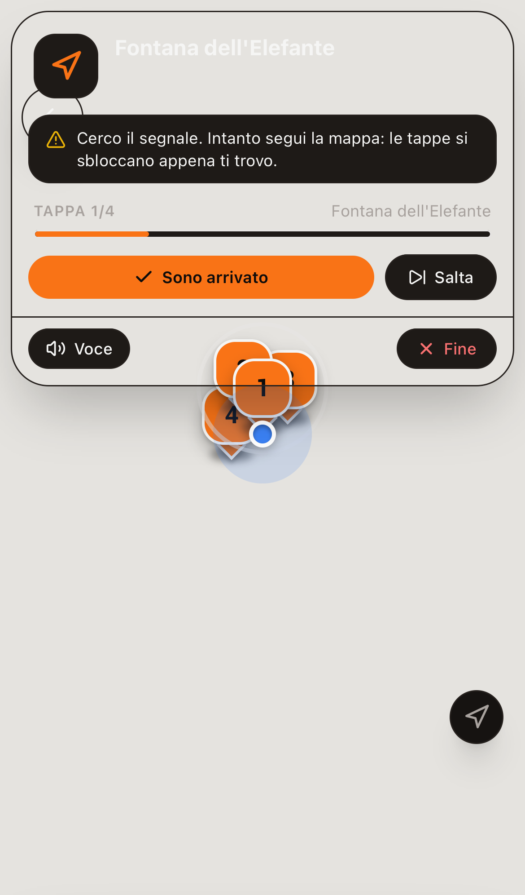 01 segnale in attesa | 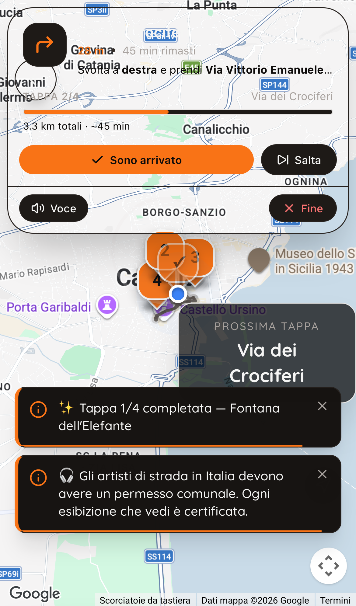 02 il segnale arriva, tappa sbloccata |
| 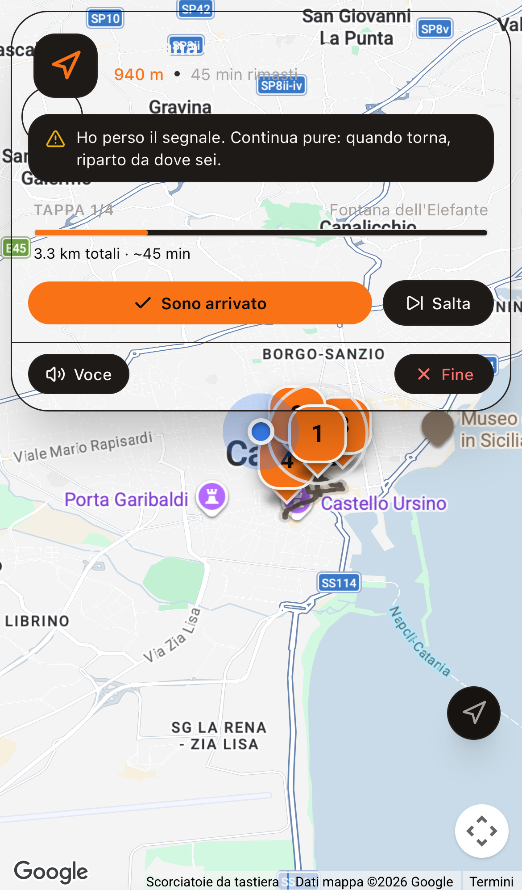 04 segnale perso | 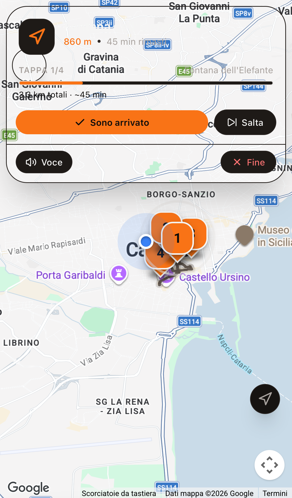 05 segnale tornato |
| 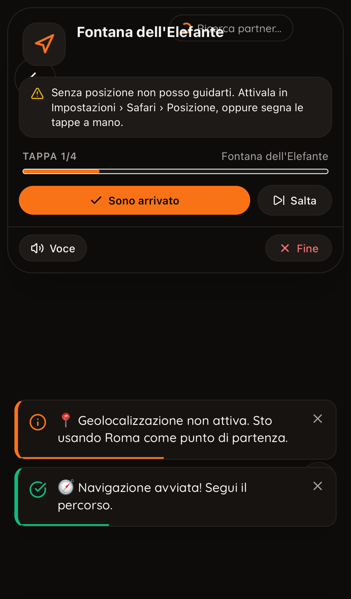 06 posizione negata | 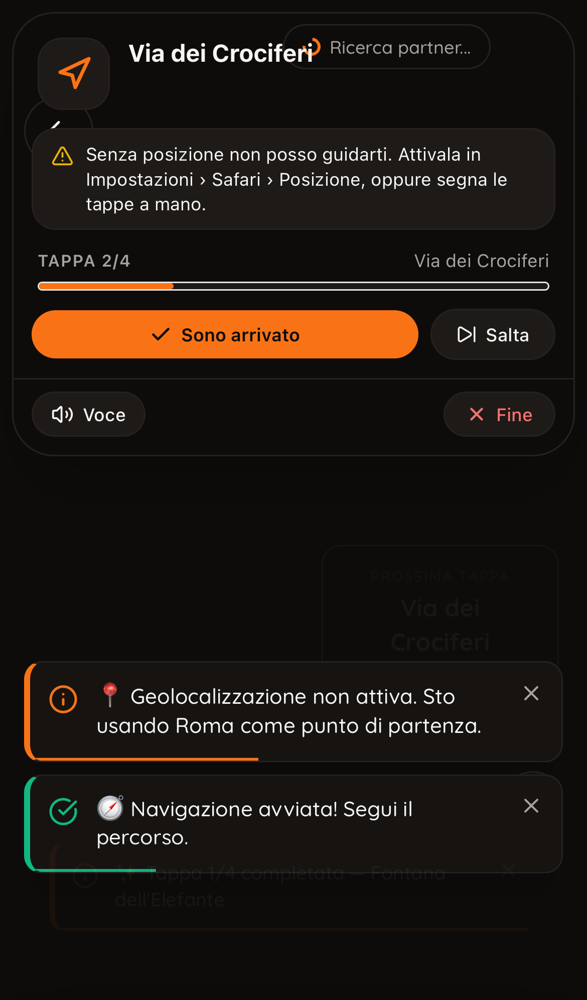 07 tappa segnata a mano |
| 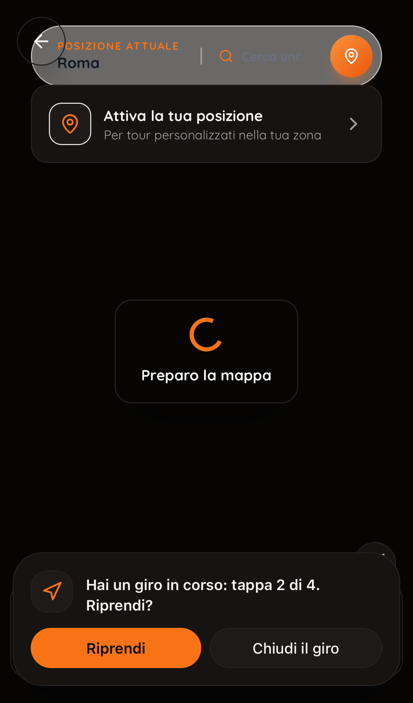 08 dopo la ricarica | 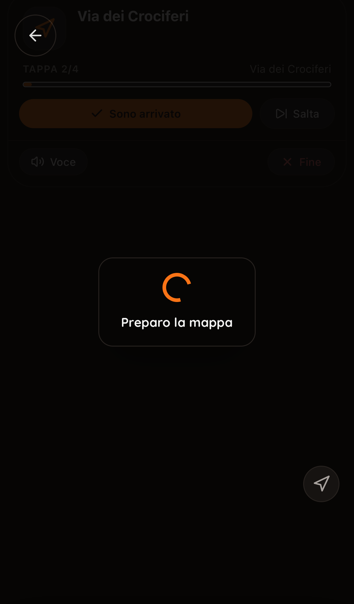 09 giro ripreso |
| 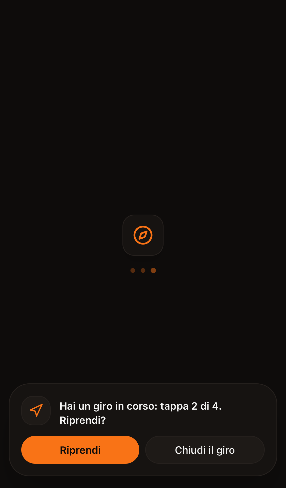 10 proposta all'apertura dell'app | 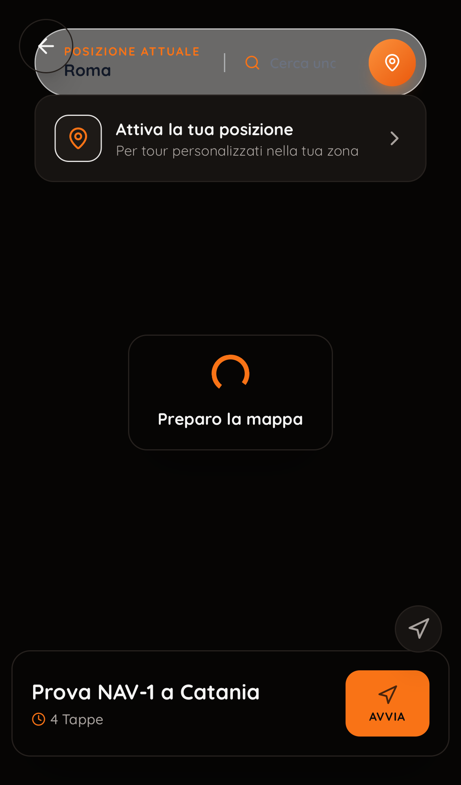 11 oltre 12 ore: niente proposta |
| 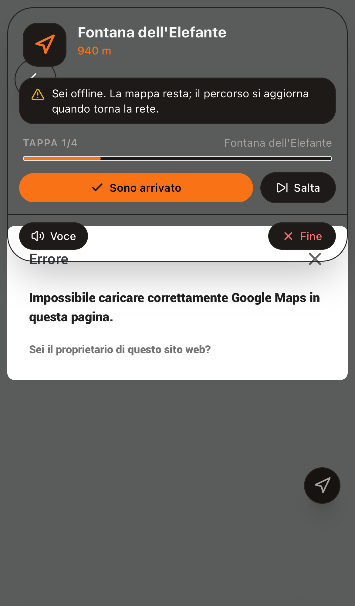 12 senza rete | 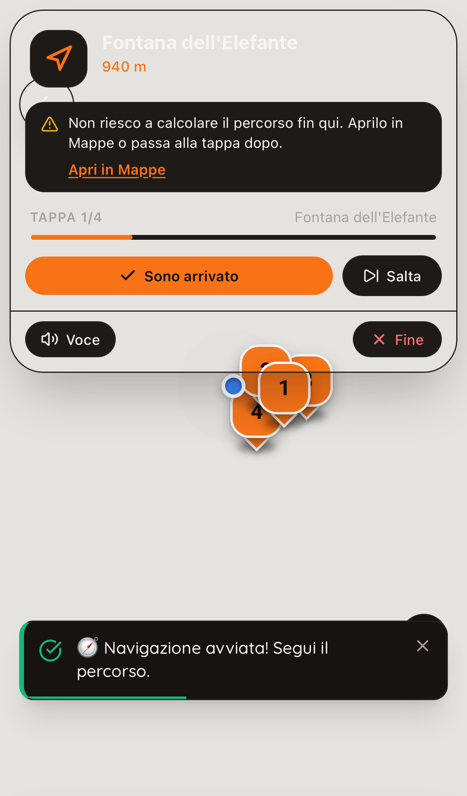 13 percorso non calcolabile |
| 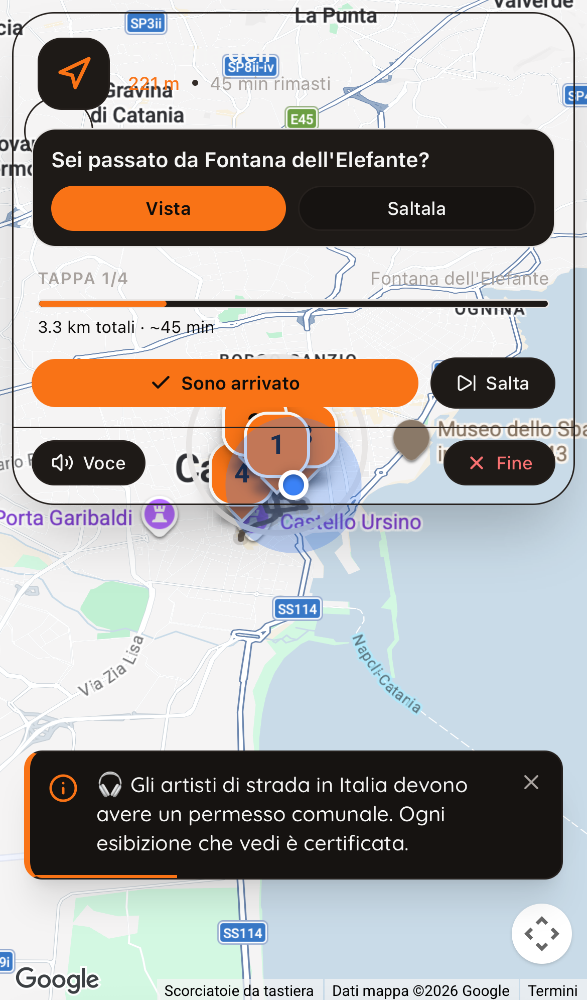 14 tappa superata | 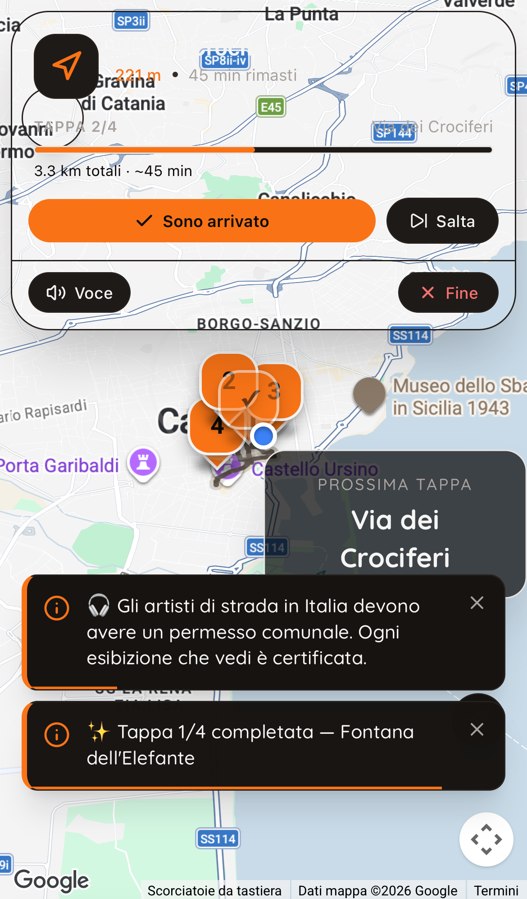 15 «Vista» |

`03-gps-ok.png` è lo stato prima del silenzio della prova 2.

**Un difetto che c'era già, visibile nelle schermate e non toccato (proposta):**
- la barra di navigazione **non ha sfondo**: si vede la mappa sotto e il nome della tappa in alto, bianco, sparisce sulla mappa chiara (schermate 01, 13);
- la causa è `bg-obsidian-card/95`: Tailwind 3 non sa applicare l'opacità a un colore definito come variabile CSS (`--obsidian-card`), quindi la classe non genera niente;
- è nel codice di main, non in NAV-1. Nei componenti nuovi (avvisi, domanda, dialogo) ho usato uno sfondo pieno;
- **proposta:** `bg-obsidian-card` senza `/95` nella barra. Una riga: la lascio a una decisione di Ivano o della corsia estetica.

## 4) Cosa NON si può provare senza un iPhone vero

1. **Lo schermo che resta acceso:** se iOS concede davvero il Wake Lock in Safari e nell'app aggiunta alla Home, e se lo rilascia col risparmio energetico.
2. **Il GPS vero:** quanto tarda il primo fix al chiuso, la precisione in mezzo ai palazzi, se iOS manda posizioni da fermi (da cui dipende il «segnale perso» a 30 s per chi sta fermo a lungo davanti a una tappa).
3. **Lo schermo bloccato e il background:** che iOS sospenda il GPS e che al ritorno il watch riparta, e la domanda «Sei passato da…?» dopo 5 minuti a telefono bloccato.
4. **La scheda scaricata da iOS:** che al ritorno Safari ricarichi `/map` col tour nello stato e proponga la ripresa (in WebKit ho simulato con una ricarica).
5. **Il permesso:** il vero dialogo di Safari, il percorso Impostazioni › Safari › Posizione e il ritorno nell'app senza ricaricare.
6. **La rete vera** che cade e torna (in WebKit è l'interruttore di Playwright) e la mappa che resta.
7. **«Apri in Mappe»:** che su iPhone apra l'app Mappe e non il sito.
8. **La voce** (B12) e la leggibilità all'aperto, col sole, dei nuovi avvisi.

## 5) Lista di controllo per la prova di Ivano sull'iPhone (8 passi)

Prima: Safari, entrato in Vercel per aprire l'anteprima (sezione 6) e nell'app; un giro di almeno 3 tappe vicine.

1. **Avvio al chiuso:** avvia il giro in casa. Entro pochi secondi «Cerco il segnale…»; esci in strada: il messaggio sparisce da solo e la distanza scende camminando, senza toccare niente.
2. **Prima tappa col GPS:** cammina fino alla prima tappa: «Tappa 2/N» e la mappa vola alla seconda.
3. **Schermo acceso:** cammina 3 minuti col telefono in mano senza toccarlo: lo schermo non si spegne.
4. **Schermo bloccato e tappa superata:** blocca lo schermo, passa oltre la tappa successiva senza fermarti, sblocca dopo almeno un minuto: compare «Sei passato da [nome]?». Prova «Saltala».
5. **Comandi nella barra:** alla tappa dopo usa «Sono arrivato» dalla barra, senza aprire la scheda.
6. **Ripresa:** a metà giro chiudi Safari dal multitasking (scorri via), riapri e torna all'app: deve comparire «Hai un giro in corso: tappa N di M. Riprendi?», con N giusto. «Riprendi» riparte dalla stessa tappa.
7. **Rete:** attiva la modalità aereo per 30 s: «Sei offline…»; disattivala: sparisce, il percorso torna.
8. **Posizione negata:** Impostazioni › Safari › Posizione → «Nega», torna e avvia un giro: messaggio con le Impostazioni; rimetti «Consenti» e torna su Safari: il segnale riparte senza ricaricare. Segna una tappa a mano.

Per ogni passo: sì/no e una schermata se no.

## 6) Anteprima e accesso

- **Indirizzo del ramo:** https://unnivai-git-nav-1-aispace-projects.vercel.app (deploy `https://unnivai-jcth652l1-aispace-projects.vercel.app`, preview, Ready, commit della funzione).
- **Stato dell'accesso: non verificato da me.**
  - L'anteprima è dietro la **protezione dei deploy di Vercel**: ogni pagina rimanda a `vercel.com/sso-api`, quindi prima di DoveVai serve l'account Vercel della squadra.
  - Lo strumento Vercel collegato a questa sessione non vede il progetto (404). La CLI vede il deploy, ma per entrare dovrei creare un accesso di bypass, cioè cambiare un'impostazione: non l'ho fatto.
  - Quindi non so se l'accesso a DoveVai (Supabase) funziona sull'anteprima.
  - **L'accesso con email e password non dipende dagli indirizzi autorizzati in Supabase**, che contano per i link nelle email e per gli accessi esterni. Mi aspetto che funzioni, ma non l'ho provato.
- **Cosa serve:** Ivano apre il link dall'iPhone essendo entrato in Vercel, oppure condivide il link dal pannello di Vercel («Share»). Nessuna impostazione cambiata.

## 7) Stato

- Ramo `nav-1`, pubblicato su GitHub. Nessun merge su main. `AGENTS.md` non committato.
- Suite **2084 verde** (159 file), lint 0 errori, build ok.
- File:
  - nuovi: `src/lib/navTracking.js`, `navSession.js`, `navPassaggio.js`, `wakeLock.js`, `navMessaggi.js`, `src/components/GiroInCorso.jsx`, `src/components/Map/GiroRipresaDialog.jsx`;
  - modificati: `src/pages/MapPage.jsx`, `src/components/Map/NavigationHUD.jsx`, `src/App.jsx`, `CLAUDE.md` (sezione NAV-1);
  - prove: due file di test, lo script WebKit, schermate, esiti.
- **Spesa:** nessuna chiamata a OpenAI. Google Maps JS e Directions vere nelle prove WebKit: qualche decina di caricamenti e di percorsi, dentro la quota gratuita di Google (stima, non misurata).
- **Telemetria non toccata.** Conseguenze da sapere per NAV-2:
  - «Salta» non lascia eventi;
  - un giro chiuso con «Fine» dopo dei salti conta come `nav_abandon`, come prima;
  - la ripresa non apre un `nav_start` nuovo.

## Cosa ho dato per vero senza verificarlo

1. **Che il GPS finto rappresenti Safari.** La prova WebKit usa il motore di Safari, ma la posizione e il suo ritmo li decide la prova. Il comportamento vero del GPS di iOS (ritmo, timeout, posizioni da fermi) non l'ho visto.
2. **Che iOS mandi posizioni regolari anche da fermi.** Se non lo fa, chi resta fermo più di 30 s davanti a una tappa vede «Ho perso il segnale…» finché il watch riavviato non risponde. Da guardare al passo 1 o 3 della lista.
3. **Le soglie della tappa superata** (80 m, 40 m di allontanamento, 60 s di pausa, 30 m di margine): scelte da me, non calibrate su strada. Possono fare una domanda di troppo con un GPS molto impreciso, mai uno sblocco sbagliato.
4. **Che `localStorage` sopravviva alla scheda scaricata da iOS e alla riapertura da Home.** È il comportamento noto di Safari; in modalità privata o col blocco dei dati del sito il salvataggio fallisce in silenzio e la ripresa non c'è.
5. **Che Safari riporti `/map` con lo stesso tour dopo uno scaricamento.** Se riapre un'altra pagina, la proposta arriva da `GiroInCorso`, ma solo con l'utente già entrato. La sessione di Supabase di solito resta, ma non l'ho verificato su iPhone.
6. **Che l'accesso all'app sull'anteprima funzioni:** non l'ho potuto aprire (protezione di Vercel). Sezione 6.
7. **Che gli errori di pagina delle prove 4 e 5 vengano dalla rete interrotta**, e non da un difetto: lo deduco dal testo degli errori (Supabase interrotto, pezzi di Google Maps non caricati), senza averli rincorsi.
8. **Il costo di Google delle prove:** stimato dentro la quota gratuita, non letto dalla console di Google.
