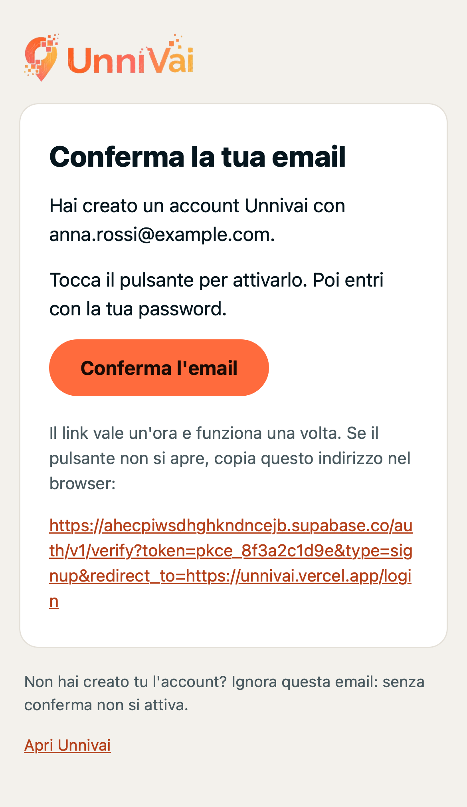
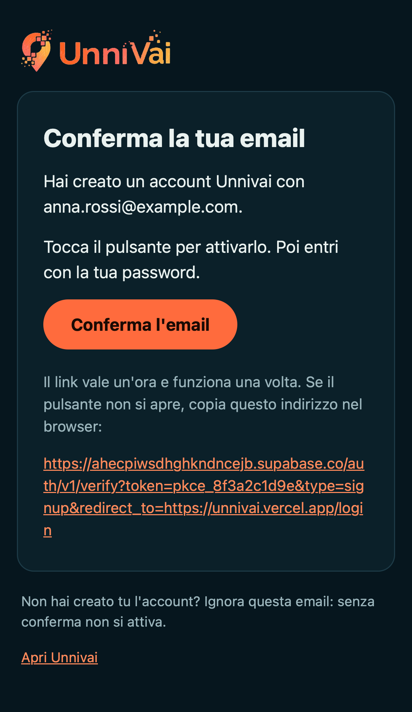
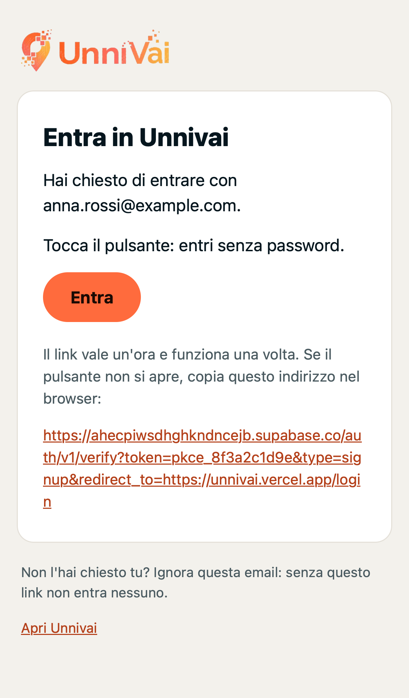
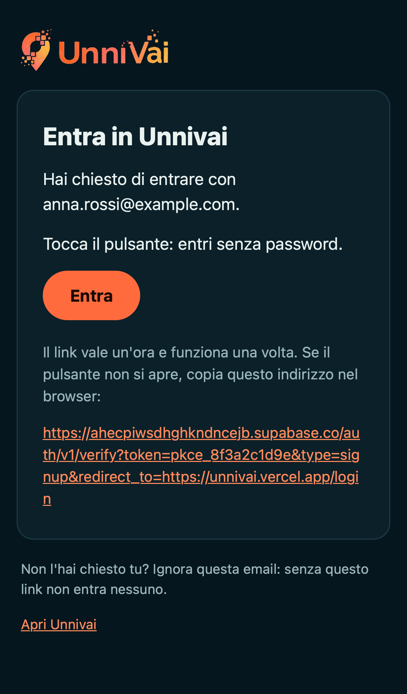
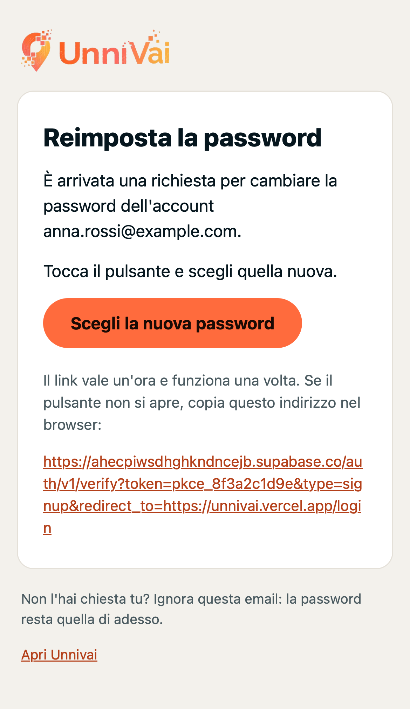
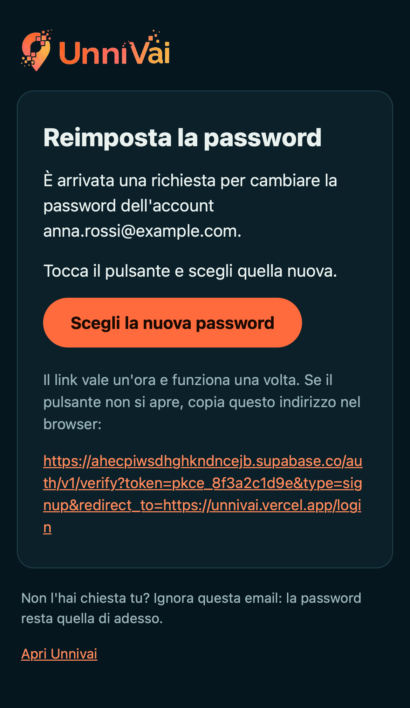
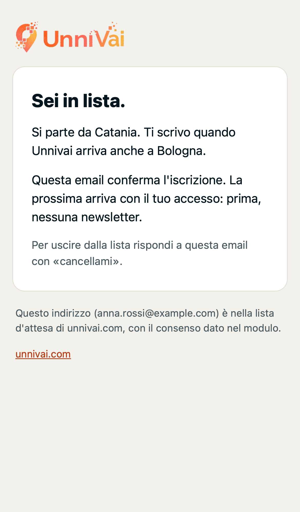
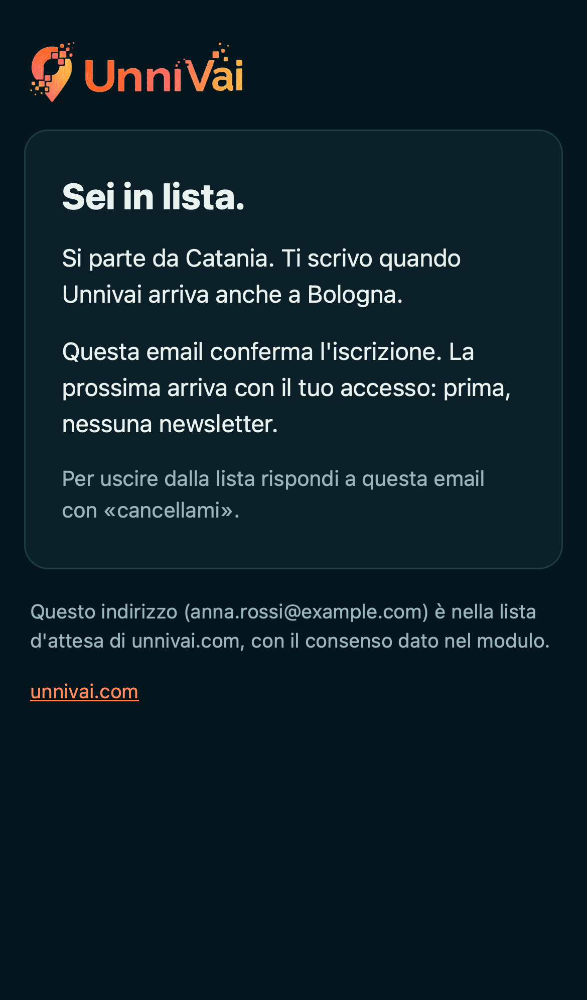
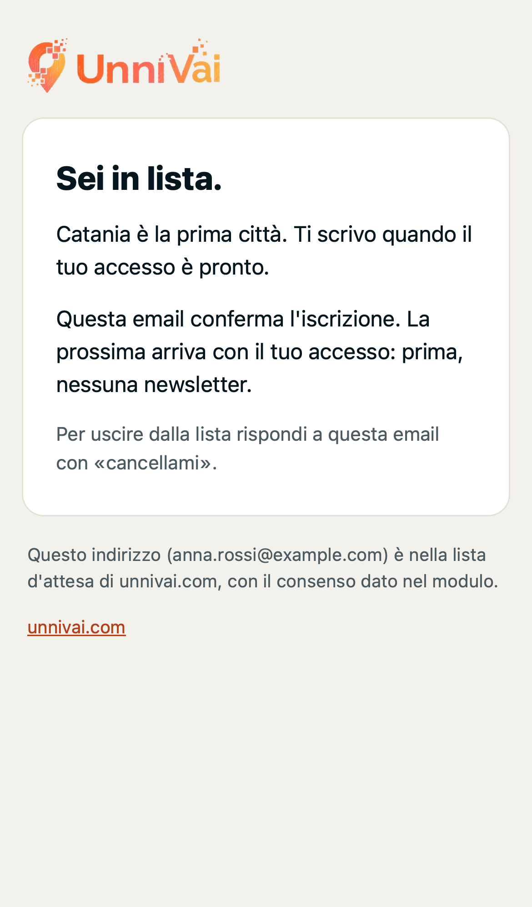
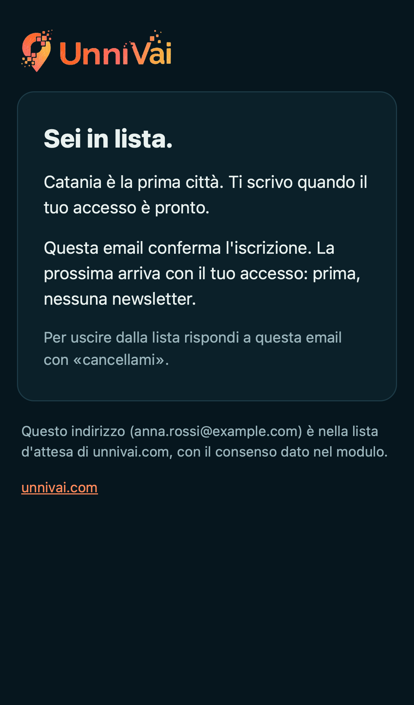

# EMAIL-LANCIO — le quattro email di Unnivai (02/11/2026)

Cartella `/Users/mac2023ivanosciretta/unnivai-email-lancio` (verificata con `pwd`), ramo `email/lancio` da `origin/main` (`4f67944`).
In questo task nessuna email inviata, nessun secret, nessun record DNS, nessuna modifica alla configurazione Auth di produzione.
Sul database solo letture (`select`); la migrazione è verificata solo con `supabase db push --dry-run`.

## 1. Diagnosi

### Chi invia oggi

**Il servizio email integrato di Supabase.** Letto con la Management API (`GET /v1/projects/ahecpiwsdhghkndncejb/config/auth`, token della CLI, mai stampato):

| Campo | Valore in produzione | Cosa vuol dire |
|---|---|---|
| `smtp_host`, `smtp_user`, `smtp_admin_email`, `smtp_sender_name` | vuoti; `smtp_pass` non impostata | nessun SMTP proprio: mittente predefinito di Supabase |
| `rate_limit_email_sent` | **2** | al massimo 2 email all'ora per tutto il progetto |
| `mailer_autoconfirm` | `false` | la conferma email è attiva: ogni registrazione manda una email |
| `site_url` | **`http://localhost:3000`** | vedi il difetto sotto |
| `uri_allow_list` | **vuoto** | nessun indirizzo di ritorno ammesso |
| `mailer_otp_exp` | 3600 | i link valgono un'ora (le email lo dicono) |
| `mailer_subjects_*` | «Confirm Your Signup», «Your Magic Link», «Reset Your Password» | soggetti in inglese |
| `mailer_templates_*_content` | i modelli predefiniti, 105–144 caratteri, in inglese | nessun logo, nessuna voce Unnivai |
| `hook_send_email_enabled` | `false` | nessun invio personalizzato |

**Limiti del servizio integrato** (documentazione ufficiale letta oggi, [Send emails with custom SMTP](https://supabase.com/docs/guides/auth/auth-smtp) e [Test auth flows](https://supabase.com/docs/guides/auth/testing-auth-flows)):
- manda **solo agli indirizzi dei membri del team** dell'organizzazione; ogni altro indirizzo fallisce con `email_address_not_authorized`;
- ha un tetto orario per tutto il progetto (qui `rate_limit_email_sent = 2`); oltre, 429 `over_email_send_rate_limit`;
- nessuna garanzia di consegna: è pensato per provare Auth, non per la produzione.
Con un SMTP proprio Supabase manda a tutti e porta il tetto a 30 all'ora (modificabile in Rate Limits).

### Il difetto dei redirect (si corregge in configurazione, non nel codice)

Il codice chiede:
- **conferma**: `src/pages/Login.jsx:98`, `emailRedirectTo: ${window.location.origin}/login`;
- **reset**: `src/context/AuthContext.jsx:141`, `redirectTo: ${window.location.origin}/update-password`;
- **magic link**: nessuna chiamata a `signInWithOtp` in `src/` (l'app entra solo con email e password).

Con `uri_allow_list` vuoto Supabase non accetta quei due indirizzi e rimanda al `site_url`, cioè **`http://localhost:3000`**.
Chi tocca il link viene confermato sul server (`/auth/v1/verify`), poi il browser apre una pagina che non esiste.
Per il reset è peggio: la sessione di recupero arriva su localhost e la password non si può cambiare.
I redirect del codice restano quelli di oggi: la correzione è il passo 5 di Ivano (Site URL e Redirect URLs).

### Cosa è successo finora (dati veri, sola lettura)

- `auth.users`: 6 utenti, tutti confermati. Ultima email di conferma partita il **25/07/2026**. Quattro conferme via link, toccato fra 16 secondi e 5 minuti dopo l'invio (13/02–25/07). Due utenti non hanno mai ricevuto la conferma (confermati senza email). `recovery_sent_at` è vuoto per tutti: **nessun reset mai chiesto**.
- `auth.audit_log_entries`: vuota. I log di Auth (`auth_logs`, `auth_audit_logs`) tengono solo l'ultimo giorno, dalle 01:22 UTC del 02/11: 904 righe, **nessun invio di email, nessun errore di invio, nessun rate limit**; solo 11 accessi con password dell'account di prova.
- `public.waitlist`: **0 righe**; `public.city_interest`: 0 righe.

### Cosa arriva e cosa no

| Email | Oggi |
|---|---|
| Conferma della registrazione | parte dal servizio integrato, in inglese; arriva solo agli indirizzi del team, al massimo 2 all'ora; il link porta a `localhost:3000`. A un indirizzo esterno la registrazione fallisce e l'app mostra «Qualcosa non ha funzionato. Riprova tra poco.» (`erroriAuth.js` non ha il codice `email_address_not_authorized`). |
| Link di accesso | non parte mai: nessun flusso dell'app lo chiede. Modello in inglese. |
| Reset della password | si chiede da Login («password dimenticata»); stessi limiti della conferma; il link porta a `localhost:3000`. Mai usato. |
| Lista d'attesa | **nessuna email**. |

### La lista d'attesa

- La pagina è **unnivai.com**, progetto Vercel `unnivai-site` (team `aispace-projects`), **non questo repo**. Il modulo fa un `POST` diretto a `/rest/v1/waitlist` con la chiave anon (`Prefer: return=minimal`, 409 trattato come «già in lista»).
- Dopo l'invio la pagina scrive «Sei in lista.» e una di tre frasi: «Ti scrivo una volta, quando il tuo accesso è pronto. Nessuna newsletter prima.», «Catania è la prima città: ti scrivo quando il tuo accesso è pronto…», «Si parte da Catania. Ti scrivo appena UNNIVAI arriva anche a X…».
- Nel database nessun trigger, nessuna funzione, nessun webhook su `waitlist`; `pg_net` non è installata (`pg_available_extensions`).

### Il dominio

- `dig NS unnivai.com` → `ns1.vercel-dns.com`, `ns2.vercel-dns.com`. `vercel domains inspect unnivai.com --scope aispace-projects`: registrar Vercel, scade l'11/10/2027, progetto `unnivai-site` (unnivai.com, www.unnivai.com).
- Record oggi: TXT `google-site-verification`, ALIAS del dominio e `*` verso Vercel, CAA. **Nessun MX, nessun SPF, nessun DKIM, nessun DMARC.**
- `app.unnivai.com` risponde 404 (non assegnato): l'app vive su **`unnivai.vercel.app`** (progetto Vercel `unnivai`).
- Logo: `https://unnivai.com/logo.png` (441×125, PNG trasparente, arancione: si legge su chiaro e su scuro). In `public/` di questo repo non c'è un logo.

## 2. La proposta: Resend dal dominio unnivai.com

- **Le tre email di Auth** passano dallo SMTP di Resend impostato in Supabase: `smtp.resend.com`, porta 465, utente `resend`, password = chiave API di Resend (documentazione [Resend + Supabase SMTP](https://resend.com/docs/send-with-supabase-smtp)). Mittente `Unnivai <ciao@unnivai.com>`.
- **L'email della lista d'attesa** la manda l'Edge Function `lista-attesa-email` con l'API di Resend. La chiama un trigger dopo ogni insert in `waitlist` (pg_net), con il solo id della riga. La funzione:
  - legge la riga con il service role;
  - la «prende» scrivendo `email_inviata_at` solo se è vuota, così un'iscrizione riceve una sola email;
  - spedisce con `Idempotency-Key: lista-attesa-<id>`;
  - se Resend sbaglia, rimette `email_inviata_at` a vuoto (si può rimandare);
  - ha un **tetto di 30 email all'ora** (`LISTA_ATTESA_MAX_ORA`): protegge il dominio se qualcuno riempie il modulo con indirizzi altrui; oltre il tetto risponde 429 e la riga resta da mandare;
  - nei log scrive solo l'id e l'esito, mai l'indirizzo né la chiave.
- Chiavi solo nei secret: `RESEND_API_KEY` (obbligatoria), `LISTA_ATTESA_RISPONDI_A` (obbligatoria: l'indirizzo che riceve i «cancellami»; `ciao@unnivai.com` non ha una casella), `EMAIL_MITTENTE` e `LISTA_ATTESA_MAX_ORA` facoltative. Senza le due obbligatorie la funzione non manda niente (503).
- `scripts/controlla-chiavi.mjs` ora blocca anche una chiave Resend (`re_…`) nei file tracciati e in `dist/`.

### File

| File | Cosa |
|---|---|
| `supabase/functions/_shared/emailUnnivai.ts` | fonte unica delle quattro email: guscio HTML, testi, soggetti |
| `supabase/templates/conferma.html`, `accesso.html`, `password.html`, `soggetti.json` | i tre modelli di Auth generati (`node --experimental-strip-types scripts/email/genera-modelli.mjs`); un test li confronta con la fonte |
| `scripts/email/carica-modelli.mjs` | carica i tre modelli con la Management API (prova di difetto, `--invia` per scrivere, poi rilegge) |
| `supabase/functions/lista-attesa-email/index.ts` | l'Edge Function della lista d'attesa |
| `supabase/migrations/20261102160000_lista_attesa_email.sql` | `pg_net`, colonna `email_inviata_at`, funzione e trigger `waitlist_invia_email` |
| `scripts/email/anteprime.webkit.mjs` | le anteprime qui sotto |
| `src/__tests__/email/modelliEmail.test.js` | voce, variabili, struttura delle email (23 test) |
| `src/__tests__/functions/listaAttesaEmail.test.js` | la funzione con Resend e Supabase finti (7 test) |

**Migrazione**: `supabase db push --dry-run` (CLI 2.117.0, da questa cartella collegata al progetto) elenca **solo** `20261102160000_lista_attesa_email.sql`.

**Perché i modelli si caricano con la Management API e non con `config.toml` + `supabase config push`.** Il repo non ha `supabase/config.toml`.
`supabase config push` manda la configurazione di tutto il progetto: un `config.toml` nuovo porta i valori locali di difetto (Site URL, rate limit, conferma email…) e li scriverebbe in produzione.
`carica-modelli.mjs` fa un `PATCH /v1/projects/{ref}/config/auth` con **solo** i 6 campi dei tre modelli (`mailer_subjects_{confirmation,magic_link,recovery}`, `mailer_templates_{…}_content`), poi rilegge e confronta.
La prova di oggi (sola lettura) dice: tutti e 6 i campi «cambia» (per esempio conferma 137 → 4346 caratteri).

## 3. I modelli

Voce: fatti e frasi brevi, nessun aggettivo da brochure, mai «Benvenuti», nessun esclamativo.
La lista d'attesa usa la prima persona («Ti scrivo») come la pagina di unnivai.com, e le stesse tre frasi.

| Email | Oggetto | Testo |
|---|---|---|
| Conferma | Conferma la tua email per Unnivai | **Conferma la tua email.** Hai creato un account Unnivai con {{ .Email }}. Tocca il pulsante per attivarlo. Poi entri con la tua password. [Conferma l'email] Il link vale un'ora e funziona una volta. Se il pulsante non si apre, copia questo indirizzo nel browser: {{ .ConfirmationURL }}. — Non hai creato tu l'account? Ignora questa email: senza conferma non si attiva. [Apri Unnivai → {{ .SiteURL }}] |
| Link di accesso | Il tuo link per entrare in Unnivai | **Entra in Unnivai.** Hai chiesto di entrare con {{ .Email }}. Tocca il pulsante: entri senza password. [Entra] (scadenza e link copiabile come sopra) — Non l'hai chiesto tu? Ignora questa email: senza questo link non entra nessuno. |
| Reset della password | Reimposta la password di Unnivai | **Reimposta la password.** È arrivata una richiesta per cambiare la password dell'account {{ .Email }}. Tocca il pulsante e scegli quella nuova. [Scegli la nuova password] (scadenza e link copiabile) — Non l'hai chiesta tu? Ignora questa email: la password resta quella di adesso. |
| Lista d'attesa | Sei nella lista d'attesa di Unnivai | **Sei in lista.** + una delle tre: «Ti scrivo quando il tuo accesso è pronto.» / «Catania è la prima città. Ti scrivo quando il tuo accesso è pronto.» / «Si parte da Catania. Ti scrivo quando Unnivai arriva anche a {città}.» Poi: «Questa email conferma l'iscrizione. La prossima arriva con il tuo accesso: prima, nessuna newsletter.» «Per uscire dalla lista rispondi a questa email con «cancellami».» — Questo indirizzo ({email}) è nella lista d'attesa di unnivai.com, con il consenso dato nel modulo. Con versione solo testo. |

`{{ .Token }}` non c'è: l'app non ha una schermata per scrivere un codice, quindi l'email non lo promette.

**Fatte per i client di posta**: layout a tabelle (`role="presentation"`), stili in linea, larghezza massima 520 px.
Il logo è un'immagine con URL assoluto `https://unnivai.com/logo.png` e `alt="Unnivai"`, non un allegato. Nessun testo dentro le immagini.
Modalità scura:
- `<meta name="color-scheme" content="light dark">` e `supported-color-schemes`;
- `@media (prefers-color-scheme: dark)` con i colori della pagina unnivai.com (`#06161E`, `#EAF2F0`, arancione `#FF6B3D` con testo `#1A0A04`);
- `[data-ogsc]` per Outlook.com;
- i colori chiari di partenza reggono l'inversione automatica di Gmail.
La città e l'indirizzo del modulo pubblico entrano solo come testo (escape), al massimo 40 caratteri.

**Il test** `modelliEmail.test.js` controlla su oggetto e testo visibile di tutte e 5 le varianti:
- le parole vietate di `BANNED_VOICE_WORDS` (l'elenco unico del repo, via `filterBannedWords`);
- le regole di voce di `racconto.ts` («benvenut», superlativi in -issimo, aggettivi da brochure, «voi»), più gli esclamativi e le emoji;
- frasi fino a 25 parole;
- le variabili (`{{ .ConfirmationURL }}` ×3, `{{ .SiteURL }}`, `{{ .Email }}`, nessuna variabile sconosciuta);
- meta e media query della modalità scura, una sola immagine (il logo, assoluto), nessuno script;
- i file del repo uguali alla fonte;
- l'escape.
Un caso di prova sbagliato apposta («Benvenuti… bellissimo e imperdibile!») viene preso.

### Anteprime (Playwright WebKit, iPhone 14, chiaro e scuro)

`node --experimental-strip-types scripts/email/anteprime.webkit.mjs` — variabili di Supabase sostituite con valori d'esempio, logo caricato dal suo URL (controllato).
WebKit con `prefers-color-scheme` è il motore di Apple Mail, non Apple Mail: l'inversione di Gmail non si vede qui.

| Email | Chiaro | Scuro |
|---|---|---|
| Conferma |  |  |
| Link di accesso |  |  |
| Reset della password |  |  |
| Lista d'attesa (Bologna) |  |  |
| Lista d'attesa (Catania) |  |  |

## 4. I passi di Ivano, in quest'ordine

1. **Account Resend e dominio.** Su resend.com → Domains → Add domain `unnivai.com`. Regione consigliata: **EU (Ireland, eu-west-1)**, utenti in Italia. Nelle impostazioni del dominio **spegni il tracciamento di click e aperture**: riscrive i link e i link di Supabase smettono di funzionare (nota della documentazione Supabase sui modelli).
2. **Record DNS su Vercel** (il DNS di unnivai.com è su Vercel, team `aispace-projects`). I valori esatti li mostra Resend; con la regione EU sono:
   ```bash
   vercel dns add unnivai.com send MX feedback-smtp.eu-west-1.amazonses.com 10 --scope aispace-projects
   vercel dns add unnivai.com send TXT "v=spf1 include:amazonses.com ~all" --scope aispace-projects
   vercel dns add unnivai.com resend._domainkey TXT "<il valore p=… copiato da Resend>" --scope aispace-projects
   vercel dns add unnivai.com _dmarc TXT "v=DMARC1; p=none;" --scope aispace-projects
   ```
   - Il nome va senza il dominio (`send`, non `send.unnivai.com`).
   - Con un'altra regione il valore MX cambia (`feedback-smtp.<regione>.amazonses.com`): vale quello di Resend.
   - Dai click: vercel.com → team aispace-projects → Domains → unnivai.com → DNS Records → Add.
   - Controllo: `dig +short MX send.unnivai.com`, `dig +short TXT send.unnivai.com`, `dig +short TXT resend._domainkey.unnivai.com`.
3. **Verifica del dominio**: in Resend → Domains → unnivai.com → Verify, fino a «Verified».
4. **La chiave API**: Resend → API Keys → Create. Permesso «Sending access», solo il dominio unnivai.com. Si vede una volta sola. Serve in due posti: password SMTP (passo 5) e secret della funzione (passo 7).
5. **SMTP e indirizzi in Supabase.**
   Dalla dashboard: Authentication → Emails → SMTP Settings → Enable custom SMTP.
   - Sender email `ciao@unnivai.com`;
   - Sender name `Unnivai`;
   - Host `smtp.resend.com`;
   - Port `465`;
   - Username `resend`;
   - Password = la chiave del passo 4;
   - Minimum interval: 60 s, come oggi.

   Poi Authentication → URL Configuration:
   - Site URL `https://unnivai.vercel.app`;
   - Redirect URLs `https://unnivai.vercel.app/login` e `https://unnivai.vercel.app/update-password` (corregge il difetto dei link verso localhost).

   Poi Authentication → Rate Limits: «emails sent per hour» deve essere 30 (oggi 2).
   Oppure con la Management API (la chiave non resta nella cronologia della shell):
   ```bash
   export SUPABASE_ACCESS_TOKEN=…   # token personale da supabase.com/dashboard/account/tokens
   read -s RESEND_API_KEY
   curl -sS -X PATCH https://api.supabase.com/v1/projects/ahecpiwsdhghkndncejb/config/auth \
     -H "Authorization: Bearer $SUPABASE_ACCESS_TOKEN" -H "Content-Type: application/json" \
     -d "{\"smtp_admin_email\":\"ciao@unnivai.com\",\"smtp_sender_name\":\"Unnivai\",\"smtp_host\":\"smtp.resend.com\",\"smtp_port\":\"465\",\"smtp_user\":\"resend\",\"smtp_pass\":\"$RESEND_API_KEY\",\"smtp_max_frequency\":60,\"rate_limit_email_sent\":30,\"site_url\":\"https://unnivai.vercel.app\",\"uri_allow_list\":\"https://unnivai.vercel.app/login,https://unnivai.vercel.app/update-password\"}" -o /dev/null -w "%{http_code}\n"
   ```
   (`smtp_port` è una stringa nella Management API.) Quando l'app passerà su `app.unnivai.com` (DOM-1), Site URL e Redirect URLs vanno aggiornati; il vecchio indirizzo resta in lista durante il passaggio.
6. **I modelli in Supabase**, dal repo, con la Management API (vedi sopra perché non `config push`), dalla cartella su main aggiornato:
   ```bash
   SUPABASE_ACCESS_TOKEN=… node scripts/email/carica-modelli.mjs           # prova: elenca i 6 campi che cambiano
   SUPABASE_ACCESS_TOKEN=… node scripts/email/carica-modelli.mjs --invia   # scrive e rilegge: «6 campi uguali ai file del repo»
   ```
   Se un testo cambia: si modifica `supabase/functions/_shared/emailUnnivai.ts`, `node --experimental-strip-types scripts/email/genera-modelli.mjs`, test, merge, poi di nuovo questo passo.
7. **Secret e deploy della funzione**, dopo il merge e la CI verde, dal codice su main:
   ```bash
   supabase functions deploy lista-attesa-email --project-ref ahecpiwsdhghkndncejb --no-verify-jwt --use-api
   supabase secrets set RESEND_API_KEY=<chiave del passo 4> LISTA_ATTESA_RISPONDI_A=<la casella che legge i «cancellami»> --project-ref ahecpiwsdhghkndncejb
   # facoltativi: EMAIL_MITTENTE="Unnivai <ciao@unnivai.com>" (difetto), LISTA_ATTESA_MAX_ORA=30 (difetto)
   ```
8. **La migrazione** (dopo il passo 7, così la prima iscrizione trova la funzione pronta):
   ```bash
   supabase db push --dry-run   # deve elencare solo 20261102160000_lista_attesa_email.sql
   supabase db push
   ```
   Rimandare le righe rimaste senza email (tetto orario, Resend giù, iscrizioni arrivate prima dei secret):
   - per ognuna: `curl -X POST https://ahecpiwsdhghkndncejb.supabase.co/functions/v1/lista-attesa-email -H "Content-Type: application/json" -d '{"id":"<id>"}'`;
   - gli id: `select id from public.waitlist where email_inviata_at is null;`.
9. **La prova**: la tabella qui sotto.

## 5. La prova delle 4 email

Da fare dopo i passi 1–8, solo verso indirizzi di prova di Ivano.

| # | Email | Come farla partire | Cosa controllare | Esito |
|---|---|---|---|---|
| 1 | Conferma | registrazione su `https://unnivai.vercel.app/login` con un indirizzo nuovo di Ivano (un alias `+…` del suo Gmail arriva nella stessa casella) | arriva da «Unnivai <ciao@unnivai.com>», in italiano, logo visibile, chiaro e scuro su iPhone Mail. Il pulsante apre `unnivai.vercel.app/login` (non `localhost:3000`) e l'account risulta confermato. In Gmail «Mostra originale»: SPF, DKIM e DMARC = PASS | in attesa dei passi di Ivano |
| 2 | Link di accesso | nessun tasto nell'app: `curl -X POST https://ahecpiwsdhghkndncejb.supabase.co/auth/v1/otp -H "apikey: <VITE_SUPABASE_ANON_KEY>" -H "Content-Type: application/json" -d '{"email":"<indirizzo di prova>","create_user":false}'` | arriva, il pulsante apre `unnivai.vercel.app` già entrati | in attesa dei passi di Ivano |
| 3 | Reset della password | Login → «password dimenticata» con l'indirizzo di prova | il pulsante apre `unnivai.vercel.app/update-password` e la password nuova funziona | in attesa dei passi di Ivano |
| 4 | Lista d'attesa | iscrizione su `https://unnivai.com` con un indirizzo di prova, una volta con Catania e una con un'altra città | arriva entro un minuto con la frase giusta per la città. `select email_inviata_at from public.waitlist where email = '<indirizzo>'` non è vuota. Una risposta arriva a `LISTA_ATTESA_RISPONDI_A`. Dopo la prova: `delete from public.waitlist where email = '<indirizzo>'` (SQL editor) | in attesa dei passi di Ivano |

**Indirizzi di prova di Ivano trovati nei documenti** (solo da dove vengono):
- `sciretta.clienti@gmail.com`: in `supabase/migrations_archivio/20260711_is_unlimited_profiles.sql`, riga 14. In `auth.users` ci sono 2 utenti con indirizzo che comincia per `sciretta.clienti`.
- L'**account di prova**: `TEST_ACCOUNT_EMAIL` in `.env.local` (non tracciato, CLAUDE.md «Prove reali»). Dai log di Auth è un alias `+` dello stesso Gmail. L'indirizzo non si scrive qui: è una credenziale.

## 6. Cosa NON risolve

- **La pagina della lista d'attesa promette «Ti scrivo una volta»** e ora arriva anche la conferma dell'iscrizione. L'email lo dice («Questa email conferma l'iscrizione. La prossima arriva con il tuo accesso»). La frase della pagina sta nel progetto `unnivai-site`, non in questo repo: da decidere se cambiarla.
- **Nessun doppio consenso e nessun captcha sul modulo**: chiunque può iscrivere un indirizzo altrui. Il tetto di 30 email all'ora e l'indice unico sull'indirizzo limitano il danno, non lo tolgono.
- **Uscita dalla lista a mano**: il «cancellami» arriva a `LISTA_ATTESA_RISPONDI_A` e la riga si cancella dall'SQL editor. Nessun link di disiscrizione automatico.
- **`ciao@unnivai.com` non riceve posta**: nessun MX sul dominio principale. Le risposte alle email di Auth (dove Supabase non permette un Reply-To) vanno perse.
- **L'email di benvenuto all'accesso** (quando l'accesso è pronto) non esiste: è un'altra email, da scrivere quando ci sarà l'accesso.
- **Il nome**: le email dicono «Unnivai», la pagina di login dell'app dice ancora «DOVEVAI» (`Login.jsx`).
- **L'errore `email_address_not_authorized`** non ha una frase italiana in `src/lib/erroriAuth.js` (oggi esce la frase generica). Con lo SMTP proprio non capita più, quindi non è toccato.
- **Il link di accesso** è pronto ma nessun flusso dell'app lo usa (nessuna funzione nuova senza richiesta).
- **Le altre email di Auth** (cambio email, invito, riautenticazione, avvisi di sicurezza) restano i modelli inglesi di Supabase; oggi nessun flusso dell'app le manda e gli avvisi sono spenti.
- **Il logo dipende da `unnivai-site`**: se quel progetto smette di servire `/logo.png`, le email restano senza logo (resta l'`alt`).
- **Gmail e Outlook in modalità scura** non si possono provare in WebKit: si guardano nella prova del passo 9.
- **I prefetch dei link** (antivirus aziendali che aprono i link prima dell'utente, nota della documentazione Supabase) possono consumare il link monouso: non è gestito.

## Controlli prima del merge

- `npm run test:run`: 248 file, 3092 test verdi (nuovi: 23 in `modelliEmail.test.js`, 7 in `listaAttesaEmail.test.js`, 1 in `controllaChiavi.test.js`).
- `npm run lint`: 0 errori. `npm run build`: ok. `node scripts/controlla-chiavi.mjs` e `--dist`: nessuna chiave.
- `npm run banco:guardia`: **12/12**, pertinenza senza ❌ nuovi.
- `supabase db push --dry-run`: solo `20261102160000_lista_attesa_email.sql`.
