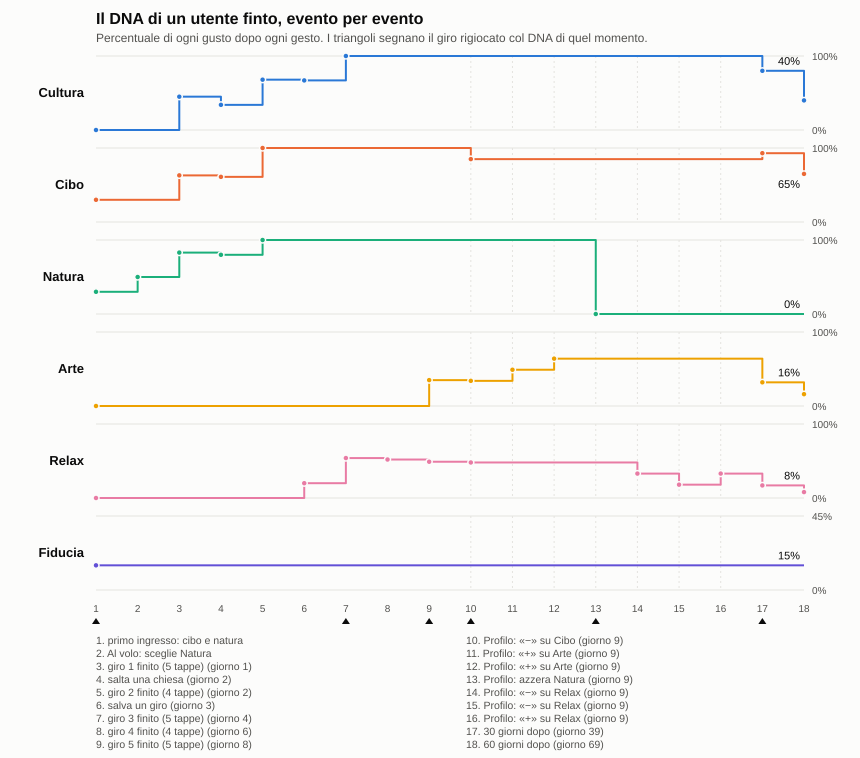

# IMPOSTAZIONI-VERIFICA (T29) — ogni impostazione cambia davvero il giro

Ramo `notte/impostazioni-verifica`. Nessuna migrazione, nessuna funzione del server, nessun secret, nessun deploy.

## Cosa cambia per Ivano

Prima parecchie impostazioni non facevano niente. Misurate col selettore spento, cioè senza il caso del modello:

| Prima | Adesso |
|---|---|
| Su misura, Interessi con una frase scritta: Arte, Cibo, Storia, Natura, Shopping davano il giro **identico** al giro senza interessi, a Roma e a Catania | Ogni chip cambia il giro: dal 27% al 65% di tappe diverse |
| Budget Medio e Lusso: giro **identico** a quello senza budget. Economico identico a Catania | Lusso porta i locali cari: prezzo medio dei pasti 3,50 a Roma e a Catania nel giro vero (senza budget 2,50 e 2,00) |
| Al volo, Gruppo: non arrivava al motore | In coppia, amici e famiglia: pasto da 75 minuti invece di 60. Famiglia a Catania: una tappa in meno |
| Al volo, Natura a Catania: Piazza del Duomo e Via Etnea, con Villa Bellini a due passi | Tre tappe di verde, poi il pranzo |
| Al volo, Storia a Roma: restava 1 posto su 38, stesso giro di Natura | Colosseo, Museo del Foro Romano |
| Su misura, 2-3 Giorni a Roma: **giro vuoto** (il selettore si fermava a metà risposta) | 29 tappe a Roma, 35 a Catania |
| Su misura, frase con mattina, pranzo e sera: partiva alle 18 e perdeva il resto | Va dalla prima fascia all'ultima |
| Profilo: «−» a 0% lasciava un debito, il «+» dopo non muoveva niente | Una correzione parte dal valore che vedi |

Le regole del motore non si sono allentate: tetto di 1,2 km, orari, pasti restano uguali. Pesi del DNA, dimezzamento e curva non cambiano: quelle sono decisioni tue e stanno in fondo come proposte.

## Quali impostazioni esistono a schermo

| Impostazione | Su misura (`AiItinerary`) | Al volo (`QuickPath`) | Chi la legge |
|---|---|---|---|
| Budget | Economico, Medio, Lusso | **Non esiste** | `resolveFoodPrefs` (tetto), `foodPrefBonus` (spinta, nuova), prompt del selettore (nuovo) |
| Durata | Mezza Giornata, 1 Giorno, 2-3 Giorni | Veloce, Medio, Lungo | `resolveTourWindow` |
| Gruppo | Solo, Coppia, Famiglia, Amici | Solo, In coppia, Con gli amici, In famiglia | `dnaGiro` (`REGOLE_COMPAGNIA`), scheletro, prompt del selettore |
| Ritmo | Rilassato, Attivo, Intenso | **Non esiste**: solo l'umore Relax dà Rilassato | `buildDaySkeleton`, `giroDna` |
| Interessi | Arte, Cibo, Storia, Natura, Shopping, Vita Notturna | **Non esistono**: al loro posto umore e sotto-scelta | Chip: `interessiGiro.js` (nuovo). Umore: frase per il traduttore, categoria, `bonusUmore` |
| Richiesta scritta | Sì | **No** | traduttore, `richiestaNelGiro`, finestra |

## Come si è misurato

- **Stesso luogo e ora**: Roma e Catania, giovedì 5/11. Su misura alle 9:30 con «Domani, una giornata a X», 1 Giorno. Al volo alle 11:00, Città, Medio, Solo.
- **Giro vero**: 63 casi con l'account di prova, selettore acceso.
- **Selettore spento** (`scripts/impostazioni/varianti.giro.js`, 0 $): gli stessi tracciati, sceglie il codice. Due varianti uguali danno lo stesso giro, quindi ogni differenza viene dall'impostazione.
- **Coppia di controllo**: la stessa impostazione due volte.

### Il rumore

| Coppia di controllo | Selettore acceso | Selettore spento |
|---|---|---|
| Su misura Roma | 53% di tappe diverse, −2,28 km, 12 contro 10 tappe | identico |
| Su misura Catania | 74% di tappe diverse, −0,66 km, 11 contro 13 tappe | identico |
| Al volo Roma | identico | identico |
| Al volo Catania | identico | identico |

**In Su misura due giri uguali differiscono per più di metà delle tappe.** Una percentuale di tappe diverse dal vivo non prova niente da sola. Conta come «oltre il rumore» una differenza a selettore spento, oppure una misura che supera quella del controllo: minuti del giro e minuti dei pasti (0 nel controllo), prezzo dei pasti oltre 0,50 (a Roma il controllo passa da 2,50 a 2,00), tappe oltre 2, km oltre 2,28.

Un dato da sapere: **il selettore decide poco.** Delle tappe finali di Su misura solo da 0 a 3 su 12 restano quelle scelte dal modello, le altre le mette il riparatore. Per questo a Roma i chip Cibo e Shopping danno lo stesso giro (Antica Caciara, tipo `food_store`, vale per tutti e due) e tre giri di Shopping sono usciti uguali. Il comportamento non viene da T29: il neutro ha 0 tappe del modello su 12.

## Tabella, impostazione per impostazione

Neutro nel giro vero: Su misura Roma 12 tappe, 6,44 km, 705 minuti, pasti 150 minuti, prezzo 2,50. Catania 11 tappe, 3,44 km, 705 minuti, pasti 150 minuti, prezzo 2,00. Al volo Roma 3 tappe, 0,90 km, 150 minuti. Catania 4 tappe, 0,49 km, 180 minuti.

«Spento» è la quota di tappe diverse dal neutro a selettore spento; «uscita» vuol dire che il tracciato non aveva una ricerca e il confronto non vale.

### Su misura

| Impostazione | Cambia | Roma: giro vero | Catania: giro vero | Spento Roma / Catania | Oltre il rumore |
|---|---|---|---|---|---|
| Budget Economico | sì | prezzo pasti 2,00 | prezzo 2,00 (uguale) | 61% / 38% | a selettore spento sì (Catania 1,67); dal vivo il prezzo sta nel rumore |
| Budget Medio | poco | prezzo 2,00 | prezzo 2,00 (uguale) | 61% / **identico** | solo a Roma: è la fascia che il pool ha già |
| Budget Lusso | sì | prezzo **3,50** | prezzo **3,50** | 61% / 56% | sì |
| Durata Mezza Giornata | sì | 6 tappe, 255 min | 6 tappe, 255 min | 71% / 57% | sì |
| Durata 2-3 Giorni | sì | 29 tappe, 1815 min | 35 tappe, 2115 min | uscita / 63% | sì |
| Gruppo Solo | poco | pasti −30 min | pasti −30 min | 53% / 0% | sì nei minuti |
| Gruppo Coppia | sì | pasti +15 min | pasti +35 min | 61% / uscita | sì |
| Gruppo Amici | poco | pasti +15 min | pasti +15 min | 0% / 0% | sì nei minuti, le tappe no |
| Gruppo Famiglia | sì | 9 tappe, −3,52 km | 8 tappe, −1,33 km | 38% / 53% | sì |
| Ritmo Rilassato | sì | 8 tappe, −3,20 km | 9 tappe, −1,99 km | 60% / 53% | sì |
| Ritmo Attivo | **no** | identico al neutro (selettore spento) | identico | identico | è il passo di difetto: scelta di progetto |
| Ritmo Intenso | sì | 15 tappe, +122 min | 14 tappe, +117 min | 58% / 35% | sì |
| Interessi Arte | sì | entra Galleria Spada | entra una galleria d'arte | 59% / uscita | sì |
| Interessi Cibo | sì | entra Antica Caciara | 3 soste da mangiare, pasti +20 min | 63% / 47% | sì |
| Interessi Storia | sì | 13 tappe | 9 tappe | 61% / 65% | sì |
| Interessi Natura | sì | Giardino degli Aranci, Belvedere | Villa Bellini | 53% / uscita | sì |
| Interessi Shopping | poco | entra Antica Caciara: stesso giro di Cibo | nessun negozio | 63% / 27% | cambia il giro, non porta negozi veri |
| Interessi Vita Notturna | sì | +95 min (dopocena) | +95 min | 44% / 38% | sì |
| Richiesta articolata | sì | da Piazza Navona a un aperitivo con vista, tutto il giorno | mercato del pesce, street food, chiese, Via Crociferi: 5 voci su 5 nel giro | – | sì |
| Chip senza frase | sì | Arte 9 tappe con Galleria Doria Pamphilj, Natura 10 | non misurato | – | sì |

### Al volo

| Impostazione | Cambia | Roma | Catania | Oltre il rumore |
|---|---|---|---|---|
| Durata Veloce | sì | 2 tappe, 67 min, niente pasto | 2 tappe, 51 min, niente pasto | sì |
| Durata Lungo | sì | 4 tappe, 240 min | 5 tappe, 240 min | sì |
| Gruppo In coppia | poco | pasto +15 min, stesse tappe | pasto +15 min, stesse tappe | sì nei minuti |
| Gruppo Con gli amici | poco | pasto +15 min, stesse tappe | pasto +15 min, stesse tappe | sì nei minuti |
| Gruppo In famiglia | poco | pasto +15 min, stesse tappe | una tappa in meno, pasto +15 min | sì nei minuti |
| Umore Natura | sì | 80% di tappe diverse: giardini | 86%: Villa Bellini | sì |
| Umore Storia | sì | 100% | 40% | sì |
| Umore Gusto (Roma) | sì | 80–100% | non c'è a Catania | sì |
| Umore Relax (Catania) | sì | non c'è a Roma | 83%: spa | sì |
| Sotto-scelta (Roma, Rioni invece di Piazze) | sì | 100% | una sola sotto-scelta a Catania | sì |

Le tabelle complete stanno in `docs/prove/dati/impostazioni-verifica/` (`giro-vero.json`, `tracciati.json.gz`). Per rifarle a 0 $: `IMP_OUT=<file> npx vitest run -c scripts/impostazioni/vitest.impostazioni.config.js`, poi `node scripts/impostazioni/tabella-finale.mjs <giro-vero> <file>`.

## Difetti corretti

Ognuno ha il suo test in `impostazioniT29.test.js`, `dnaCorrezioni.test.js`, `dna5.test.js`, `dnaRegistroPagine.test.js`, `tourWindow.test.js`, `quickPathRitmoUmore.test.jsx`.

1. **Chip Interessi senza effetto** (`src/lib/interessiGiro.js`). Spinta sui posti del tipo principale di Google, riga nel prompt del selettore. Una ricerca sola se il chip è scoperto e la frase ha trovato qualcosa.
2. **Budget solo come tetto**. Ora spinge la sua fascia (`BUDGET_BONUS`), il selettore vede il prezzo, una ricerca se la fascia manca. Solo per il budget del modulo: quello del primo accesso prende la spinta, non la ricerca.
3. **Le spinte non arrivavano al riparatore**. Stile, compagnia, budget e chip contavano solo per entrare nel pool. Ora `repairMomentSelection({ spinta })` li somma al merito.
4. **Gruppo di Al volo perso**. `QuickPath` manda `dnaGiro` come Su misura. `buildQuickPrefs` non scrive più «Attivo»: nessuno l'aveva scelto e spegneva il passo della famiglia.
5. **Filtro «storia»**. Quasi ogni monumento porta anche `tourist_attraction` o `museum`: storia, arte e cultura ora sono una famiglia.
6. **Al volo Natura**. La categoria è natura anche se il traduttore legge «ville storiche» come storia; piazze e chiese della lista non passano davanti al verde; i locali della lista restano per i pasti.
7. **Al volo, lista contro umore**. I posti trovati dalla ricerca dell'umore hanno la spinta dei chip.
8. **2-3 Giorni vuoto**. I token del selettore crescono con le tappe (`maxTokensSelettore`).
9. **Frase con più fasce**. La finestra va dalla prima all'ultima (`fasceNelTesto`).
10. **Ritmo Intenso nel prompt**. Il confronto era in minuscolo e non scattava mai (`normalizePace`).

## Audit del DNA

Un utente finto: primo ingresso con cibo e natura, una scelta in Al volo, 5 giri, un salto, un salvataggio, 7 correzioni dal Profilo, poi 30 e 60 giorni di silenzio. I pesi vengono da `pesiDaEventi`, il giro dopo è rigiocato a selettore spento. Si rifà con `node scripts/impostazioni/dna-audit.mjs`, 0 $.

| # | Evento | Cultura | Cibo | Natura | Arte | Relax | Fiducia |
|---|---|---|---|---|---|---|---|
| 1 | primo ingresso: cibo e natura | 0 | 30 | 30 | 0 | 0 | 15% |
| 2 | Al volo: sceglie Natura | 0 | 30 | 50 | 0 | 0 | 15% |
| 3 | giro 1 finito | 45 | 63 | 83 | 0 | 0 | 15% |
| 4 | salta una chiesa | 34 | 61 | 80 | 0 | 0 | 15% |
| 5 | giro 2 finito | 68 | 100 | 100 | 0 | 0 | 15% |
| 6 | salva un giro | 67 | 100 | 100 | 0 | 20 | 15% |
| 7 | giro 3 finito | 100 | 100 | 100 | 0 | 54 | 15% |
| 8 | giro 4 finito | 100 | 100 | 100 | 0 | 52 | 15% |
| 9 | giro 5 finito | 100 | 100 | 100 | 35 | 49 | 15% |
| 10 | «−» su Cibo | 100 | 85 | 100 | 34 | 48 | 15% |
| 11 | «+» su Arte | 100 | 85 | 100 | 49 | 48 | 15% |
| 12 | «+» su Arte | 100 | 85 | 100 | 64 | 48 | 15% |
| 13 | azzera Natura | 100 | 85 | 0 | 64 | 48 | 15% |
| 14 | «−» su Relax | 100 | 85 | 0 | 64 | 33 | 15% |
| 15 | «−» su Relax | 100 | 85 | 0 | 64 | 18 | 15% |
| 16 | «+» su Relax | 100 | 85 | 0 | 64 | 33 | 15% |
| 17 | 30 giorni dopo | 80 | 93 | 0 | 32 | 17 | 15% |
| 18 | 60 giorni dopo | 40 | 65 | 0 | 16 | 8 | 15% |

**Il giro dopo lo riflette?** Solo in parte.

| Momento | Giro dopo, a selettore spento |
|---|---|
| Dal primo ingresso al giro 3 | cambia: 13 tappe e 6,58 km, poi 10 tappe e 3,81 km |
| Dal giro 3 al giro 5 | identico |
| Dopo «−» su Cibo | identico |
| Dopo azzera Natura | identico |
| 30 giorni dopo | cambia |
| Fiducia piena (45%), azzera Cultura | cambia: 62% di tappe diverse |
| Fiducia piena, azzera Natura | identico |
| Fiducia piena, «+» tre volte su Relax | identico |

Una correzione cambia sempre la percentuale e, al cambio di gradino, Per Te (la fascia passa da `cultura2+food2` a `arte2+cultura2`). Sul giro di Su misura cambia solo se tocca un gusto forte che il pool di quella città ha davvero. A fiducia 15% pesa troppo poco per spostare le ancore.

### I sei sospetti

| # | Sospetto | Esito | Cosa si è fatto |
|---|---|---|---|
| 1 | I salti dei collaudi pesano | **Vero, ma il calcolo è giusto.** Cultura sull'account di prova: 243 raggiunte (+10,10), 46 chiusure (+11,98), 8 salvati (+1,20), 257 saltate (−22,57) = +0,71. Una differenza piccola fra numeri grandi: un salto cancella due tappe raggiunte | Nessuna modifica: è un peso. Proposta sotto |
| 2 | Tre gusti al 100% non si distinguono | **Vero.** Con 5 tappe a giro cultura, cibo e natura stanno a 40, 78, 100: bastano **3 giri**. Da lì l'ordine è alfabetico | Nessuna modifica: è la curva. Proposta sotto |
| 3 | «−» a 0% lascia un debito | **Vero, difetto.** Anche «+» dopo tante tappe saltate non si muoveva, e «−» a 100% non si vedeva | **Corretto**: la correzione parte dal valore a schermo. ±0,15 non cambia |
| 4 | Le correzioni si attenuano | **Vero.** Un «+» vale 15, 8, 4, 2 punti a 0, 30, 60, 90 giorni. Un «−» si scioglie: Cibo sale da 85 a 93 in 30 giorni | Nessuna modifica: è il dimezzamento. Proposta sotto |
| 5 | `giriDalRegistro` fonde lo stesso tour | **Vero, difetto.** Due passaggi contavano come un giro da 6 tappe e il doppio dei km: il ritmo sembrava veloce | **Corretto**: si divide alle chiusure |
| 6 | Il limite delle 1000 righe | **Vero, ancora lontano.** A stima, con circa 14 righe a giro, si arriva a 70 giri finiti: da lì Mete e Risultati smettono di crescere. Sui pesi non cambia niente | **Corretto**: lettura a pagine fino a 5000 righe |

## Prove

- Suite, lint, build, guardia: in fondo alla PR.
- Guardia 12/12, banco 10/10, pertinenza senza ❌ nuovi.
- Banco 40 in riproduzione: 40/40 con tutti i controlli. 33 casi uguali al giro vero, 7 con tappe diverse: `b-roma-A`, `b-catania-A`, `b-catania-B`, `a-siracusa-ortigia`, `n-roma-intenso`, `n-palermo-natura`, `n-gangi-1000`. **Gli esiti salvati del banco restano quelli del giro del 3/11**: `npm run banco -- --replay` esce con 1 finché non si rifà il giro pagato.
- **Schermate**: nessuna. Il task non cambia l'interfaccia, cambia i giri. Il passaggio di `dnaGiro` da QuickPath lo prova il test della pagina.

### Tracciati della guardia

Il proxy rifiuta le liste di un giorno più vecchio di ieri (`BAD_CITY_LIST`). Con il giorno della guardia, il 15/10, `--registra` avrebbe girato senza lista. Quindi le risposte registrate restano e si aggiungono solo le ricerche nuove che il codice chiede: `scripts/impostazioni/completa-tracciati.mjs`, 14 chiamate in tutto. Il selettore di quei casi resta quello registrato.

## Costo

| Giro | Spesa a listino |
|---|---|
| Al volo prima delle correzioni | 1,604 $ |
| Prova ridotta | 0,741 $ |
| Giro finale, 63 casi | 3,495 $ |
| 2-3 Giorni e mezza giornata rifatti | 0,222 $ |
| Al volo rifatto (senza lista, buttato) | 1,322 $ |
| 26 casi rifatti con la lista | 0,867 $ |
| Ricerche aggiunte ai tracciati | 0,280 $ |
| **Totale** | **8,53 $** su 10 $ |

Circa 1,5 $ sono andati persi: dopo la mezzanotte il giorno simulato 5/11 è diventato più vecchio di ieri e 26 casi hanno girato senza lista. Sono stati rifatti tutti con `BANCO_LISTE_DA`. I 63 casi finali hanno tutti la lista.

**Il giro finale non è su un solo commit.** 37 casi sono girati prima di due correzioni: i token del selettore (conta solo oltre 13 tappe) e i locali della lista in Al volo (conta solo in Al volo). I 26 rifatti sono sul codice finale. I casi di Su misura con Intenso (14–15 tappe) hanno avuto il tetto vecchio, che è bastato.

## Cosa non risolve

- **Il rumore del selettore in Su misura** resta: più di metà delle tappe cambia fra due giri uguali.
- **Shopping non garantisce un negozio**: sposta il giro, ma a Catania non è entrato nessun negozio e a Roma solo una bottega di alimentari. I posti del tipo giusto vicini al percorso sono pochi.
- **Medio a Catania** non cambia niente: il pool è già tutto di fascia 2.
- **Il Gruppo di Al volo** cambia quasi solo i minuti del pasto: in un giro di 3 tappe non c'è spazio per altro.
- **Città e Storia a Catania** in Al volo si assomigliano: 40% di tappe diverse. Stanno nello stesso centro.
- **Spinta sulla lista**: un'ancora vale +1 e resta sopra chip e budget, per decisione di C10.
- **Il banco** chiama Al volo senza `dnaGiro`: i suoi casi restano come prima, il giro vero dell'app no. Solo i casi di T29 lo passano (`comeLaPagina`).

## Decisioni che aspettano Ivano

1. **Peso del salto**: oggi −0,10 contro +0,05 di una tappa raggiunta. Proposta: −0,05, oppure niente salti dagli account di prova.
2. **Saturazione**: tre giri portano un gusto al 100%. Proposta: un tetto più lento o un confronto fra gusti, senza toccare la fiducia.
3. **Correzioni che si sciolgono**: proposta di non far decadere `dna_correction`, o con una mezza vita più lunga.
4. **Fiducia bassa**: a 15% una correzione non sposta le tappe. Proposta: una correzione esplicita vale come una richiesta, a qualunque fiducia.
5. **Al volo**: Budget e Ritmo non esistono. Dimmi se devono esserci.
6. **Banco**: rifare il giro pagato dei 40 casi per aggiornare gli esiti, circa 8 $.
7. **Proxy**: far passare i giorni passati per l'account di prova, così `--registra` torna a valere. È una modifica del server.

## Passi che aspettano Ivano

Nessun comando. Nessuna prova su iPhone: il task non tocca voce, audio, GPS o rete.
